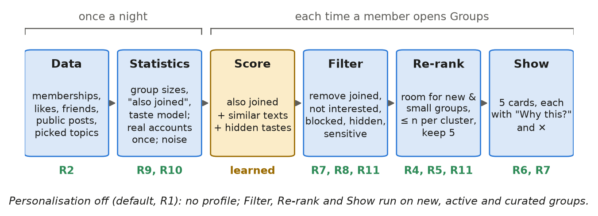

# Report build tools

**The two documents of the final design.** `results/final_choices.md` and `report/model-card.md` are not edited by hand: notebook 11
rebuilds them at the end of its section 13 with `fill_docs.py`, from the templates in `templates/` and the numbers in `results/`. To change
their text, edit the template, then run `.venv\Scripts\python report\build\fill_docs.py` from the ECSE557 folder (or rerun notebook 11).
`fill_docs.py --check` only compares, and also checks that `README.md` quotes the run's headline numbers.

One Markdown source (`../src/*.md`) gives two versions of the report:

- a **Word** file with the cover page and frog header from `../../Repport.docx`
- a **LaTeX** project that compiles with pdfLaTeX on Overleaf

`Repport.docx` and `Interim report - draft.docx` are only read, never written. Needs Python 3 with
`python-docx`, `Pillow` and `pypdfium2` (the system `py` has them). The PDF step needs Microsoft Word.

## The tools

| Tool | What it does |
|---|---|
| `py md2docx.py SRC.md OUT.docx --title "Final Report" --date "November 24, 2026"` | Builds the Word file. Optional: `--students "Students: Amine Houari and [[Teammate’s full name]]  ·  Group 14"` (this is the default; `[[...]]` is highlighted), `--template`, `--doc-title`. |
| `py md2tex.py SRC.md OUTDIR --title "Final Report" --date "November 24, 2026"` | Writes `OUTDIR/main.tex` and `OUTDIR/figures/` (the figures used, the frog and the McGill logo from Repport.docx), then `OUTDIR.zip` next to it. Takes the same `--students` and `--template` options. |
| `py check_tex.py OUTDIR` | Strict check of the LaTeX project (no TeX needed). Prints each problem with its line. Exit code 1 means there's at least one error. |
| `powershell -NoProfile -ExecutionPolicy Bypass -File docx2pdf.ps1 IN.docx OUT.pdf` | Exports to PDF with Word and prints `pages: N`. Word always quits, even on errors (a watchdog stops it after 300 s, `-TimeoutSec` changes this). If Word was already open, that window is left alone. |
| `py pages.py REPORT.pdf OUTDIR [--dpi 110] [--pages 1-3] [--sheet]` | Saves each page as `page-NN.png`, so you can look at it. `--sheet` adds `sheet.png`, a single image showing every page. |

A full run, from this folder:

```
py md2docx.py ../src/final.md ../out/final.docx --title "Final Report" --date "November 24, 2026"
powershell -NoProfile -ExecutionPolicy Bypass -File docx2pdf.ps1 ../out/final.docx ../out/final.pdf
py pages.py ../out/final.pdf ../out/pages --sheet
py md2tex.py ../src/final.md ../out/final-tex --title "Final Report" --date "November 24, 2026"
py check_tex.py ../out/final-tex
```

To open it in Overleaf: New Project > Upload Project > choose `final-tex.zip`. The compiler is pdfLaTeX (the default).

## The Markdown subset

```
# 1. Design Context                 section     (write the number yourself; nothing is auto-numbered)
## 2.1 Stakeholders                 subsection
### 2.1.1 Teenagers                 sub-subsection

A paragraph runs until a blank line. **bold**, *italic*, [[placeholder]] (shown as [placeholder] in yellow).
"Straight quotes" become curly. Escape a literal * _ | [ ] # with a backslash: \*

- a bullet                          an indented line continues the item
1. a numbered item                  numbering starts at the first number written

<!-- widths: 1.2, 3, 1 -->          optional: relative column widths (any numbers)
<!-- small -->                      optional: 8 pt table text instead of 9 pt
Table 1. The caption, right above the table.
| Header | Header | Header |
|---|:---:|---:|                     :---: centres a column, ---: right-aligns it
| cell | **R1**<br>Hard | 0.25 |      <br> breaks a line inside a cell

{width=6.2}
                                    width in inches (at most 6.5), path relative to the .md file, PNG or JPG

<!-- pagebreak -->                  start a new page
<!-- box -->                        right above or right below a heading: draws that section in a light box
# References                        its paragraphs get a hanging indent
# Appendix A. Simulator             the first appendix starts on a new page
<!-- anything else -->              a comment, ignored
```

Bare `https://` addresses become links in LaTeX. Greek letters and symbols (ε λ ≥ ≤ × ∈ ∞ → ±) can be typed
directly. md2tex converts them to math, and stops with the line number if it meets a character it has no
LaTeX form for.

## Known limits

- **Not supported:** nested lists, `[text](url)` links, inline code, footnotes, automatic citations,
  cross-references and automatic numbering. References and numbers are typed by hand.
- **LaTeX floats.** Tables and figures float (`[!htbp]`), so in LaTeX they can move slightly from where they
  sit in the text. A table must fit on one page (there's no `longtable` on the allowed package list). The Word
  version breaks long tables between rows and repeats the header row.
- **LaTeX look.** The font is Times (newtx) instead of Calibri. Tables use plain booktabs rules, without the
  green lines and shaded header row of the Word version. The box can't break across pages. Placeholders are
  highlighted word by word: they can wrap to a new line but are never hyphenated.
- **LaTeX cover.** The cover positions were measured from the Word render. The LaTeX itself was never
  compiled here (no TeX on this machine), so `check_tex.py` is the only safety net. It finds what would stop
  pdfLaTeX, but it can't see overfull lines or where floats end up. Look at the Overleaf PDF once.
- **Pictures.** Word can't place PDF images, so figures must be PNG or JPG.
- `<!-- pagebreak -->` inside a box is ignored.
