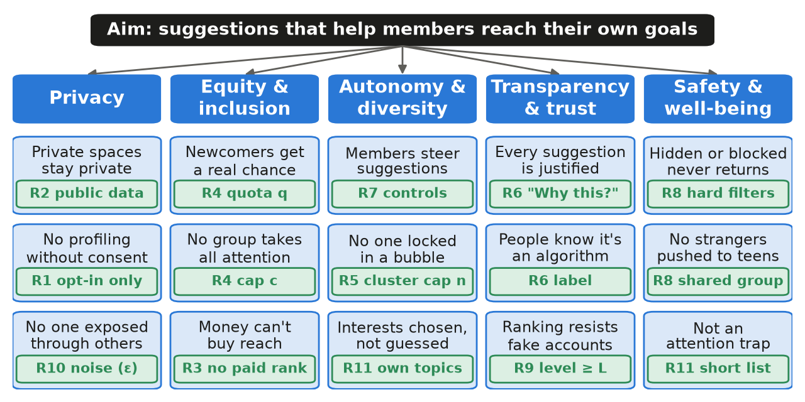
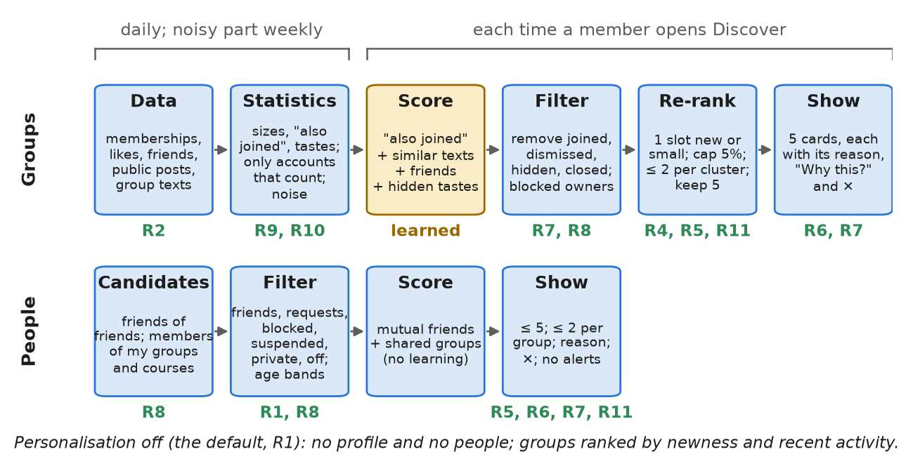

<!--
  Final report, due November 24, 2026: first version of the final text (November 19, 2026).
  Drafted with Claude (Anthropic), Claude Opus 5.5, on November 19, 2026, from the November 1 draft, the submitted interim
  report, the results files and BOING's code; the authors review and rewrite it before submitting (report/FINAL-V1-NOTES.md).
  Every number comes from a saved file (named in a caption or the text):
    groups: results/final_table.csv, final_costs.csv, final_newcomers.csv, final_reasons.csv, final_rules.json, final_config.json,
      final_privacy_scope.json, final_activity_privacy.csv, final_sybil.csv, final_sybil_posting.csv, final_promotion.csv,
      final_sabotage.json, final_reachable.json, final_topic_clusters.csv; e1_methods.csv; e2_recommendation.json,
      e2_one_dial.csv; e3_recommendation.json, e3_opt_in.csv; e4_sybil.csv, e4_recommendation.json; e5_newcomers.json;
      e6_rules.json; testcases/index.csv (results/SUMMARY.md lists them all)
    people (E7 v2, notebook 12): results/e7_methods.csv, e7_few_friends.csv, e7_costs.csv, e7_age_rules.csv, e7_opt_in.csv, e7_closure.csv,
      e7_validation.csv, e7_age_grid.csv, e7_rules.json, e7_people.json
    BOING: node tests/recs/port.js (13 of 13, 8,488 rows, run on Nov 19); tests/recs/rules.js (33,261 checks, 0 violations, with w = 0.05,
      with the age bands, reported by BOING's team on Nov 19; boing-backend/RECS-API.md)
  Page budget: the body (Sections 1 to 5) must fit in 10 pages; the cover, the AI-use declaration, the references and the
  appendices are outside the 10. The body starts on a new page so it is easy to count.
  Build (from ../build), with Python 3.14 (py -3.14), which has python-docx, Pillow and pypdfium2:
    py -3.14 md2docx.py ../src/final-nov24.md "../../Final report - Word.docx" --title "Final Report" --date "November 24, 2026" --students "Students: Amine Houari and Sehajpreet Kaur  ·  Group 14"
    powershell -NoProfile -ExecutionPolicy Bypass -File docx2pdf.ps1 "../../Final report - Word.docx" "../../Final report - Word.pdf"
    py -3.14 md2tex.py ../src/final-nov24.md ../latex/final --title "Final Report" --date "November 24, 2026" --students "..."
    py -3.14 check_tex.py ../latex/final
-->

<!-- box -->
# AI-use declaration (pre-amble)

**System.** Claude (Anthropic), used through Anthropic's Claude Code assistant, from October 11 to November 19, 2026 [[add any later use, up to submission]]; this version was drafted with Claude Opus 5.5 [[add the model versions of earlier sessions, if different]]. AI-USE-LOG.md in our repository records each use with its date, known limits and checks.

**What we did ourselves.** We chose the project and BOING as its setting, set the goals and the scope (including the cuts after the TA's feedback), decided which values become hard rules and which become dials, decided the McGill-only deployment and the age rule for people suggestions, and accepted, changed or rejected each of Claude's proposals. [[Name two or three proposals you changed or rejected, and why.]]

**What Claude did, its known limits, and our corrections.**

1. **Plan and rules.** Proposed the plan (steps T1–T9, experiments E1–E7), the report outline, a first list of rules and a handbook on building them. *Limits:* its judgement, not our stakeholders'. *Corrections:* we revised the rules to eleven and narrowed the scope twice (Section 1).
2. **References and laws.** Drafted the introduction and references; checked each DOI against Crossref, Quebec's ss. 4.1, 8.1, 9.1 and 14 against the official consolidated text (to October 15, 2026), and each Montréal number against the official PDF. *Limits:* it can misquote; the DSA's Article 28 and Ofcom's code were read through secondary sources and search excerpts, because the official pages refused automated reading. *Corrections:* three Montréal numbers were fixed (R7–R9); [[say whether you opened the DSA and Ofcom texts yourselves]].
3. **Code and experiments.** Wrote notebooks 01–12 and their shared module: the simulator and its E7 additions, the splits, the methods, the re-ranker, the privacy and fake-account experiments, the people suggestions, the rule checkers with planted faults, and the 13 test cases. *Limits:* code can run without doing what its text says; the simulator's rates, grids, seeds, attack scenarios and the E7 assumptions (ages, courses, switch shares) are its choices. *Corrections:* each notebook runs its own checks and was rerun in order from a clean kernel; every random step has a fixed seed.
4. **Two independent reviews (November 1).** Separate Claude sessions, given only the code and results, found a privacy claim broader than the noise, a fake-account bypass through the "small" line, an ε choice that did not replicate, and reasons stating noisy counts. *Limits:* the same kind of system as the author, with the same possible blind spots. *Corrections:* each issue was fixed and rerun (Section 3).
5. **The implementation in BOING.** BOING itself is built with Claude Code. Other Claude sessions ported the design to BOING's server, wrote the port test and the rule checker, built the Discover page, and added the age bands on November 19. *Limits:* the same system wrote the code and its tests. *Corrections:* the port must reproduce the 13 test cases from the Python code row by row (Section 3.6).
6. **Figures, build tools and report text.** Wrote the figure code and the Word, PDF and LaTeX build scripts, and drafted every version of this report, including this declaration, from the saved results. *Limits:* the wording is its own; it can present a hypothesis as a finding or quote a number that later changed. *Corrections:* every number was re-read from the file named next to it, and every page of the PDF was inspected.

[[What we checked or changed ourselves, task by task: e.g. re-ran notebooks 01–12, checked numbers by hand, read the two reviews, opened the sources behind Table 3, rewrote sections (which), compiled the LaTeX on Overleaf.]]

**Reflection.** [[In your own words, 3–5 sentences: how did using Claude affect your learning and your goals? What could you now explain or redo without it? When did checking its work teach you something or catch an error? Did it change what you aimed for? Make it consistent with what the interim report's pre-amble said.]]

<!-- pagebreak -->
# 1. Design Context

Recommender systems decide much of what people see online.
Most are tuned for engagement, which is easy to measure but only a proxy for what people value (Kleinberg et al., 2022).
Engagement-driven recommenders have been linked to filter bubbles (Pariser, 2011), to popularity bias, where a few items capture most of the attention (Abdollahpouri et al., 2017), to feedback loops that make behaviour more homogeneous (Chaney et al., 2018), and to profiling that intrudes on privacy and autonomy (Milano et al., 2020).
Suggesting people raises the same issues with persons in place of items: "people you may know" lists make well-connected members better connected (Su et al., 2016), and they can put strangers in touch with children, which is why the UK regulator's codes keep children out of such prompts by default (Ofcom, 2025).
These systems are usually added once a platform's incentives are fixed; a new platform can decide what its recommender is for before building it.

**BOING and its deployment.** BOING (boingsocial.com) is a free social network where a member's identity is a pixel character rather than a photograph.
It launches on November 22, 2026 as a student network for McGill University: students sign up with their McGill email address, which also verifies them for the campus space; a wallet sign-in remains only as a quiet alternative for a few early accounts, and the site has no crypto features.
BOING is independent of the university.
Students join groups (clubs and study groups) and the course rooms of their courses, add friends, plan their week and play games.
Before this project, Discover ranked groups by member count, so large groups kept growing while new ones stayed invisible, and there were no people suggestions.

**What we design, and for whom.** We design the two recommenders behind Discover's "For you": five groups to join and up to five people to befriend, each with its reason.
They serve McGill students who switch them on, and they also affect the groups and people they rank and the members whose activity feeds them.
The objective is to help students find groups and people that suit them while keeping new and small groups visible, profiling no one without consent, protecting minors and resisting fake accounts; success is judged against these values, not clicks.

**Deployment assumptions.**

1. The network is small and young, so popularity bias would lock in early winners.
2. A verified McGill address makes fake ("Sybil") accounts costlier than the wallets and ordinary email addresses of our interim assumptions, but not impossible: accounts can be borrowed or bought, and a few early wallet accounts remain.
3. Most members are 17 or older, but first-years are often 17 and BOING's minimum age is 14, so minors are a small minority, not an edge case. Ages come from a private, unverified birth year given at sign-up, used only as a safety filter.
4. BOING's mission is reaching goals and belonging, not time on site, so success is a short list of useful suggestions.
5. Quebec's private-sector privacy act, as amended by Law 25 (S.Q. 2021, c. 25), applies; the EU Digital Services Act (DSA) and the UK codes do not bind BOING, and serve as benchmarks.
6. No real member data is used: every number here comes from a synthetic community. The design runs in BOING, opt-in, but studying real members would need research ethics board (REB) approval, which we do not have.

**Approach and scope.** Following value sensitive design (Friedman & Hendry, 2019), we identify the stakeholders, their values and the tensions between them, then use the Montréal Declaration (Université de Montréal, 2018) to turn the values into eleven testable rules: seven hard limits that are never traded, and four dials set by experiments that measure what each value costs (E1–E7).
Since the interim report, three things changed.
Following the TA's feedback, we report only what we built, so the planned feed of posts and the privacy audit of BOING's AI coach are dropped; people suggestions are now built and evaluated (E7); and the design runs in BOING, where it must reproduce our test cases exactly.

**Beyond the recommender.** The same values shape the rest of BOING, although we did not evaluate these features in this project. For safety, members can block and report others, word filters and a photo check screen what is posted, and moderators review reports. For privacy, email addresses are never stored in plain text, and a member's age is never shown or used to rank anyone. And BOING avoids engagement design: the feed is newest first, points are earned rather than bought, shop items are cosmetic, and every ad is reviewed before it runs.

# 2. Design

## 2.1 Stakeholders and values

Following value sensitive design, we list everyone the recommenders affect, including indirect stakeholders who never see them (Table 1).
With no real users, the values come from BOING's policies (no paid advantages, private spaces stay private, safety tools), from published work on the harms of recommenders, and from our judgement.

<!-- widths: 2.3, 1.05, 3.15 -->
<!-- small -->
Table 1. Stakeholders of the two recommenders and the values at stake.
| Stakeholder | Type | Values at stake |
|---|---|---|
| McGill students looking for groups and friends | Direct | Relevance, autonomy (control), privacy, belonging, well-being |
| Newcomers (first-years, new members); new and small groups and clubs | Direct | A fair chance to be seen (equity), belonging |
| Members under 18, mostly 17-year-old first-years, and their parents | Direct, vulnerable | Safety, privacy, belonging with classmates |
| Group and club owners | Direct | Visibility; protection from manipulation by rivals |
| People suggested to others | Direct | Consent to be found; privacy of their groups and age |
| Members whose data feeds others' suggestions | Indirect | Not being inferred or exposed through "people like you" |
| Moderators | Indirect | Not amplifying hidden or reported content |
| McGill University | Indirect | Its students' safety and privacy, and its name; BOING is not its service |
| BOING, the operator | Indirect | Trust, growth, legal compliance |

These values pull against each other in six places (Table 2).
We call a conflict a *tension* when design can largely resolve it, and a *trade-off* when gaining one value costs another, so that an experiment must measure the price.

<!-- widths: 1.55, 0.85, 2.75, 1.35 -->
<!-- small -->
Table 2. Value tensions, how the design serves both sides, and where the price is measured (Section 3).
| Tension | Kind | How the design serves both | Measured in |
|---|---|---|---|
| Relevance vs fair exposure | Trade-off | 1 of 5 group slots for the most relevant new or small group | E2, E5 |
| Personalisation vs privacy | Trade-off | Opt-in (R1), an allow-list of data (R2), noisy statistics (R10) | E3 |
| Transparency vs manipulation | Tension | Explain the kind of reason, not the weights; count only established accounts (R9) | E4 |
| Discovery vs consent | Trade-off | Only people who switched suggestions on can be suggested | E7 |
| Belonging vs safety of minors | Tension | Age bands: minors meet 18–20-year-olds only through a tie, and are shown to them only as classmates | E7 |
| Engagement vs well-being | Tension | Five suggestions, no endless list, no notifications (R11) | E6, E7 |

## 2.2 From values to design choices

We translate values with a values hierarchy (van de Poel, 2013): each value is specified as norms that say what it demands on BOING, and each norm becomes a testable rule (Figure 1), traced to the Montréal Declaration.
Our stance is pluralist, as in the Declaration, whose principles are not ranked but bound one another: "the limits of one principle's application are defined by another principle's field of application" (p. 5).
So seven rules are hard limits, tested to zero violations, and four are dials, each set by a decision rule written before its experiment (Table 3).

{width=4.1}

In law, sections 9.1 and 8.1 of Quebec's private-sector act require privacy settings to give "the highest level of confidentiality by default, without any intervention by the person concerned", and require anyone who profiles people, including assessing their "personal preferences, interests or behaviour", to tell them first and say how to activate it; we read them together as support for R1 (our reading, not the regulator's).
Section 4.1 forbids collecting personal information from a child under 14 without a parent's consent unless it is clearly for the child's benefit, so under-14s get no personalised suggestions.
The DSA does not bind BOING (Article 19 exempts micro and small platforms from most platform duties, Articles 27 and 28 included), but R6 and R7 aim at its Article 27 on recommender transparency, and the age bands at its Article 28 on minors' privacy, safety and security.

<!-- widths: 0.5, 3.55, 1.15, 1.3 -->
<!-- small -->
Table 3. From values to design choices: what each rule became in the design and why, and when it passes. Hard rules are never traded; dials were set by the experiment named. Montréal numbers are principle.item (Université de Montréal, 2018).
| Rule | Value → design choice, and why | Montréal; law | Passes when |
|---|---|---|---|
| **R1** Hard | *Autonomy, privacy* → personalisation, and with it people suggestions, is off until the member switches it on; off, Discover still lists new and active groups. Profiling is the most intrusive step, and Law 25 asks for the most private default. | 3.4, 3.6; ss. 8.1, 9.1 | New accounts start off; never empty |
| **R2** Hard | *Privacy* → an allow-list: memberships, likes, friendships, public posts, group texts, the member's own choices; never messages, planner, coach, purchases or email. The birth year feeds only the age filter. | 3.1, 3.2, 8.4 | Private data changes nothing |
| **R3** Hard | *Equity, trust* → nothing paid or sponsored changes a rank: reach is earned, not bought. | 6.2 | Spending moves no rank |
| **R4** Dial | *Equity* → q = 1 of 5 slots for a group that is new (30 days) or small (under 10 members who count), because one slot cost 2.8% of the accuracy and a second would cost 0.022 more (E2); no group above c = 5% of all slots. | 6.2, 6.3, 7.1 | Every list holds one; none above c |
| **R5** Dial | *Autonomy, diversity* → at most n = 2 groups per topic cluster and variety λ = 0.8, nearly free (E2); at most 2 people named through one group. | 7.1, 7.4 | No list breaks n |
| **R6** Hard | *Transparency* → one reason per item from a fixed template, the part that adds most to the score, labelled as an algorithm's; a private friend or group is never named. | 5.2, 5.7, 5.8 | Every reason faithful to the score |
| **R7** Hard | *Autonomy* → "Not interested", hide a topic, reset, "what is used"; nothing is joined or sent for the member. | 2.1, 3.4, 9.2 | Dismissed items never return |
| **R8** Hard | *Safety* → never anyone blocked either way, suspended or private, nor a hidden or closed group; people only through a mutual friend or shared group, only if they switched on, and within the age bands (Section 2.3). | 1.5, 3.1, 4.1, 8.3; s. 4.1 | Zero violations; every age pair as specified |
| **R9** Dial | *Trust* → only accounts at level L = 3 or more count, each once, from 30 days old, because together these stop new or low-level fake accounts (E4). | 8.3, 6.2 | Cheap fakes change nothing |
| **R10** Dial | *Privacy of those who feed others* → each member counts for at most m = 3 groups, and group sizes and pair counts get Laplace noise for ε = 1.5, the smallest ε that kept 90% of the accuracy on five practice quizzes (E3). | 3.5, 8.4 | 90% of the accuracy kept |
| **R11** Hard | *Well-being* → five suggestions, no endless list, no notifications; no reason names an inferred interest. | 1.5, 2.6, 3.3 | At most 5 items |

## 2.3 The system and its algorithms

Figure 2 shows how both kinds of suggestion are made.
For groups, BOING reads only the allowed data (R2) and computes every statistic about other members in one place, so the rules about whose data counts (R8–R10) reach every score at once; the public part is rebuilt daily and the noisy part weekly, since each noisy release spends the privacy budget again.
Only the group score is learned: every ethical guarantee sits in fixed, testable steps around it, so a change to the model cannot break a hard rule.

{width=4.9}

**Groups.** We built the score from the simplest method upwards, so each addition had to beat the simpler ones (E1): *"also joined"*, item-to-item collaborative filtering on member overlap (Sarwar et al., 2001); *similar descriptions* (TF-IDF), which reaches new groups with no members; *hidden tastes*, our AI model, a truncated SVD of the member × group matrix with 10 tastes (Koren et al., 2009), which profiles members and is therefore opt-in; and *friends*, the member's public friends in the group.
The *hybrid* mixes them 0.2 / 0.2 / 0.3 / 0.3, the best of 286 mixes on a practice quiz under the noisy statistics.
A *fair re-ranker* then fills each list one slot at a time, trading relevance against similarity to the groups already picked (λ; Carbonell & Goldstein, 1998) under the quota, the cap and the cluster limit, applying fairness of exposure (Singh & Joachims, 2018).
Against Sybil attacks (Douceur, 2002), which push little-known items most easily (Lam & Riedl, 2004), only accounts that count under R9 enter any statistic, as Tournesol counts only trusted accounts (Hoang et al., 2021).
Laplace noise on the clipped group sizes and pair counts (Dwork & Roth, 2014) protects "also joined" and the taste model at once (McSherry & Mironov, 2009).
Each reason names the part that adds most to the score, aiming at transparency and scrutability rather than persuasion (Tintarev & Masthoff, 2007); a quota slot says why it is there, and under noise an "also joined" reason states no count.

**People.** A candidate's score is the number of mutual friends plus w times the number of shared groups and courses, with no learning, so every suggestion can be explained exactly; w = 0.05 was tuned on a practice quiz (BOING's first version used w = 1 and switched to 0.05 after E7, before the launch; Section 3.5).
The reason is the bigger of the two ("3 mutual friends", or "You're both in X", naming the smallest shared group listed to everyone, never a private one); at most two people are suggested through one group, and equal scores are ordered at random, not by sign-up date.

**The age bands (R8).** The owner of BOING decided the age rule on November 19, from the private birth year, with an unknown age counted as under 18: under-14s get no personalised suggestions and are never suggested; a viewer aged 14–17 sees other minors as usual, 18–20-year-olds only through a mutual friend or a shared group or course, and never anyone over 20; a viewer aged 18–20 sees a minor only as a classmate (the same course this term); and a viewer over 20 never sees a minor.
It replaces the binary line of our first version, adults and minors never mixed, which E7 shows cut minors' chance of finding a friend from 9.0% to 2.5%.

## 2.4 Implications and planned results

Socially, the design redistributes attention (a club founded in September can be found in October), refuses to trade privacy for accuracy without asking, and decides who can be found by whom (Section 4.2); on policy, it treats Law 25 as a requirement and the DSA and Ofcom's codes as voluntary benchmarks.
The interim report planned group suggestions well above today's ranking, about 20% of slots for new or small groups, zero hard-rule violations and a price for each rule, with people suggestions "as far as time allows" (Table 7).
For E7 we stated four hypotheses before the run: the design beats random and the most-connected people (H1); it breaks no rule and treats every age pair as specified (H2); it spreads exposure far more evenly than ranking by connections (H3); and it pays most of its price for consent, while the bands give minors more than the binary line without showing them to anyone over 20 (H4).

# 3. Results

## 3.1 Method

A simulator generates 2,000 members and 150 groups across 10 hidden topics; joins favour each member's interests and bigger groups, which reproduces the long tail of real platforms (Appendix C).
For groups, we hide 20% of the memberships of the 1,406 members with at least three groups (1,531 test memberships); every setting is chosen on a practice quiz that hides 20% of the remaining memberships again, never on the test.
For people (E7), we hide 20% of the friendships, as in link prediction (Liben-Nowell & Kleinberg, 2007), and choose the weight on a practice quiz carved from the rest. The community had no ages, courses or switch, so we added them with stated assumptions (Appendix C): 8% of members aged 13 to 17, 5% with no birth year, 160 course rooms, 1,000 friendships made in class, and 25% switching suggestions on. Its friendships almost never close a triangle, so before seeing any test result we made the main E7 world realistic: friends of friends become friends, more readily around a shared group or course (Kossinets & Watts, 2006), until the average clustering reaches 0.15, conservative next to the 0.14 Ugander et al. (2011) report at 100 friends (ours have about 9); the first world is kept as a sensitivity check.
We report relevance (the hit rate, a right answer among the five, and NDCG@5; Järvelin & Kekäläinen, 2002) and normative outcomes: shares of slots, the Gini coefficient of exposure, rule violations, whether reasons are true, what attacks achieve, what the noise covers and what each age rule gives and exposes minors to.
Every random step has a fixed seed; with noise, numbers are means of 10 draws; 95% ranges resample the members.

## 3.2 Group suggestions against today's BOING

The final design finds a hidden group for 61% of members, against 22% for today's ranking, with NDCG@5 0.488 (95% range 0.466–0.510) against 0.131 (Table 4).
It gives 20.8% of the slots to new or small groups, and all 1,406 lists hold one, where today's ranking shows none; it shows 127 groups instead of 10, and the Gini coefficient of exposure falls from 0.95 to 0.53.
The default list, with no profile, is far less relevant (0.058) but gives 44.1% of its slots to new or small groups: the price of profiling no one.
New members gain too: on a separate quiz, their NDCG@5 is 0.343 against 0.134 today.

<!-- widths: 2.3, 0.75, 1.5, 1.15, 0.85, 0.75 -->
<!-- small -->
Table 4. Group suggestions: the final design against today's BOING and its own parts (test set, 1,406 members; rows with noise: mean of 10 draws). Source: results/final\_table.csv.
| Design | Hit rate | NDCG@5 (95% range) | Slots for new or small groups | Gini of exposure | Groups shown |
|---|---:|---:|---:|---:|---:|
| Today's BOING (biggest first) | 0.220 | 0.131 (0.117–0.146) | 0% | 0.953 | 10 |
| Hybrid, no rules | 0.687 | 0.541 (0.517–0.563) | 2.1% | 0.640 | 106 |
| Final design without privacy | 0.637 | 0.515 (0.491–0.539) | 20.4% | 0.495 | 127 |
| **Final design (ε = 1.5)** | **0.613** | **0.488 (0.466–0.510)** | **20.8%** | **0.532** | **127** |
| Personalisation off (default) | 0.105 | 0.058 (0.049–0.068) | 44.1% | 0.843 | 23 |

## 3.3 What the group rules cost

E1 shows why a re-ranker is needed: the accurate methods give new or small groups almost no slots ("also joined" 2.7%, the AI model 0.5%, the hybrid 2.0%), because such groups have few memberships to learn from.
Together the rules cost 0.053 NDCG@5, 9.7% of the hybrid's accuracy (Table 5); privacy is the largest price and fair exposure the next.
Fairness gets dearer with each slot (one newcomer slot costs 0.014 NDCG@5, a second 0.022 more, a third 0.038 more; E2), and members with only one group pay most for it (0.031, 7.2%; E5).

<!-- widths: 3.6, 0.9, 1.65, 0.85 -->
<!-- small -->
Table 5. What each group rule costs on the test set: NDCG@5 lost at each step, against the step before. Source: results/final\_costs.csv.
| Step (rules) | NDCG@5 after | Cost (95% range) | Relative |
|---|---:|---:|---:|
| Hybrid, no rules | 0.541 | – | – |
| Fair exposure and variety (R4, R5) | 0.526 | 0.015 (0.010 to 0.020) | 2.8% |
| "Small" from members who count, 8 topic clusters (R4, R5) | 0.521 | 0.005 (0.002 to 0.007) | 0.9% |
| Weights re-chosen for the noise (here without noise) | 0.519 | 0.002 (−0.004 to 0.008) | 0.4% |
| Fake-account resistance (R9) | 0.515 | 0.004 (−0.003 to 0.012) | 0.8% |
| Privacy (R10: ε = 1.5, m = 3) | 0.488 | 0.026 (0.018 to 0.035) | 5.1% |
| **Every rule together** | **0.488** | **0.053 (0.043 to 0.062)** | **9.7%** |

## 3.4 Privacy, fake accounts and the hard rules

**Privacy (E3).** At ε = 0.5 or below, noisy statistics do worse than none about other members (NDCG@5 0.408 against 0.424).
Our rule picks the smallest ε whose 95% range over five practice quizzes keeps 90% of both the accuracy and the newcomer slots: ε = 1 keeps 89.7% (88.7–90.7%) and fails; ε = 1.5 keeps 92.8% (91.9–93.8%) and passes.
If only the quarter of members who opt in counted, their suggestions would fall from 0.489 to 0.283 at ε = 2 (the noise is the same size whoever counts), so everyone's memberships count, under noise, and only those who opt in are profiled.
The guarantee covers one release of the group sizes and pair counts, not the friends signal, the counts behind "small", the recent activity or the shared cap.

**Fake accounts (E4).** Without R9, 100 fake accounts that join a small new group put it into 442 of the 1,406 lists, against 21 without the attack.
With R9, 100 or 200 new or low-level accounts that join, post or like change no list, nor do 9 to 24 that push rival groups over the "small" line; patient attackers (a month old, level 3) reach 351 lists, exactly the 5% cap.
Honest members pay little: 4.4% of their memberships wait 30 days before they count for others.

**Hard rules and reasons (E6).** The checker found no hard-rule violation for any of the 1,983 members served, on or off, and caught all 26 faults planted on purpose, at least one for each of its 20 checks.
All 19,830 reasons are faithful to the computed score; read against the raw data, 97.3% of the reasons on personalised lists and all on default lists are true, the false ones being "also joined" reasons under noise, which is why they state no count.
Finally, 13 test cases fix the design's answers for BOING (Appendix D); all 13 match when rerun from their own files.

## 3.5 People suggestions (E7)

**Relevance (H1).** On the practice quiz of the main world (clustering 0.15, against 0.007 in the first), the best weight of shared groups is w = 0.05 (NDCG@5 0.041, against 0.019 for BOING's built-in w = 1): mutual friends first, shared groups breaking ties and filling the list.
On the test, the design finds a hidden friend for 15.8% of the 1,617 tested members (95% range 14.0–17.6%), against 12.9% for mutual friends alone, 3.2% for shared groups alone, 0.9% for the most-connected people and 0.8% at random (Table 6, Figure 3); BOING's first version, with w = 1, found 7.4%, because large courses swamp mutual friends.
Shared groups earn their place with newcomers: among the 28 tested members with 0 or 1 friends, mutual friends alone leave 43% with an empty list and the design none, and it finds a friend for 17.9% of them against 14.3% (a small slice: 5 and 4 members).
In the first world every method finds 2% or less.

<!-- widths: 1.85, 1.15, 0.65, 0.75, 0.65, 0.65, 0.85 -->
<!-- small -->
Table 6. People suggestions (E7, main world; test: 1,875 hidden friendships, 1,617 members; every method under the same rules). Exposure: the lists of members who switched on, over the 361 people who may be suggested. Source: results/e7\_methods.csv, e7\_few\_friends.csv.
| Method | Hit rate (95% range) | NDCG@5 | 0–1 friends: hit rate | Gini of exposure | Top 10% take | Newcomers' share (of 15.2%) |
|---|---:|---:|---:|---:|---:|---:|
| Random | 0.8% (0.4–1.2) | 0.0022 | 3.6% | 0.24 | 18% | 15.6% |
| Most connected | 0.9% (0.5–1.4) | 0.0029 | 0% | 0.98 | 100% | 0% |
| Mutual friends only | 12.9% (11.4–14.6) | 0.0581 | 14.3% | 0.48 | 31% | 6.9% |
| Shared groups only | 3.2% (2.4–4.1) | 0.0109 | 3.6% | 0.55 | 36% | 3.8% |
| **BOING design (w = 0.05)** | **15.8% (14.0–17.6)** | **0.0708** | **17.9%** | **0.40** | **25%** | **5.4%** |
| BOING's first version (w = 1) | 7.4% (6.1–8.7) | 0.0312 | 7.1% | 0.53 | 34% | 3.9% |
| BOING design, no rules | 39.3% (36.9–41.7) | 0.1907 | – | – | – | – |

**The rules hold (H2).** Across 72,440 checks, a checker that recomputes everything from the raw tables found no violation, over every list of every member, 243 planted age cases (viewers and candidates aged 13, 15, 17, 18, 19, 20, 21, 25 or unknown, linked as classmates, through a group, or through one mutual friend), and 191 planted cases in the community (someone blocked, private, suspended, switched off, dismissed, aged 13, or with a pending request).
Every age case behaved as the owner's rule says (138 allowed, 105 refused); none of the planted cases came back, while 166 did with the matching rule removed, so they were live; and the checker caught all 18 faults planted on purpose.

**Exposure (H3).** Ranking by connections gives every slot to the top 10% of the people who may be suggested (Gini 0.98); the design spreads them more evenly than any other method that uses the network (Gini 0.40, 96% of them shown at least once).
But newcomers are still under-exposed: they are 15.2% of those who may be suggested and get 5.4% of the slots, the rich-get-richer effect Su et al. (2016) measured.

**What the rules cost, and the age bands (H4).** All the rules together cost 0.120 NDCG@5 (0.105 to 0.135), 63% of the unconstrained score.
Consent is the largest price (0.090, 0.076 to 0.103): with 25% switched on, only 32% of tested members have a friend-to-be who can be suggested at all (83% if everyone switched on); the safety filters cost 0.024, mostly because 22% of profiles are private, and the age bands 0.006 (0.002 to 0.011).
Minors (14 to 17, or no birth year; 201 tested) find a hidden friend 2.5% of the time under the binary line, 9.0% under the bands and 10.9% with no age rule.
Under the bands, no one over 20 is ever shown a minor (109 slots with no age rule), 18–20-year-olds see minors only as classmates (58 slots, against 55 classmate and 62 non-classmate slots with no rule), and under-14s are never shown and get no list.

{width=4.7}

## 3.6 The system in BOING

The group method is ported line by line to BOING's server (recs-core.js).
On the 13 test cases (8,488 rows), the port gives the same groups in the same order, the same reasons and scores within 0.000001; 75 rows differ only in which group an AI-model reason names when every link is zero, a numerical tie decided by rounding noise in the Python code.
Two documented substitutes keep it light (another eigen-solver, with the same subspace; an AI model learned from the 120 largest groups); the noise and the clipping hash draw from a secret seed; the noisy statistics are released weekly; and BOING adds one thing the course design lacks, a list of groups its team can pick for the default list, logged and never sold.
For people, an age known only from the birth year is treated as a range, with every doubt resolved on the safer side; "classmates" means both joined the same course room this term; and under-14s cannot switch suggestions on.
A rule checker on a local copy of BOING with a fake McGill community made 33,261 rule checks with w = 0.05, with the noise off and on and every age pair, and found no violation.
The Discover page has the switch, "Why this?", × (Not interested), hide a topic and reset (Figure 4).
It runs in BOING since the McGill launch on November 22, 2026, off by default; nothing in this report comes from real members.

{width=4.1}

## 3.7 Did the design meet its objectives?

<!-- widths: 1.75, 1.6, 2.6, 0.55 -->
<!-- small -->
Table 7. The objectives of Section 1, what the interim report planned, and what we found.
| Objective | Planned (interim) | Result | Met? |
|---|---|---|---|
| Relevant group suggestions | Well above today's ranking | NDCG@5 0.488 against 0.131; hit rate 61% against 22% | Yes |
| New and small groups seen | About 20% of the slots | 20.8%, in every list; Gini 0.95 to 0.53 | Yes |
| No profiling without consent | Off by default, never empty | Off by default; the default list's price: NDCG@5 0.058 | Yes |
| Privacy of members who feed others | ε set by experiment | ε = 1.5, m = 3, for the counts it covers; four signals outside | Partly |
| Resist fake accounts | R9 set by E4 | Cheap fakes change nothing; patient ones reach the 5% cap | Partly |
| Rules hold, reasons honest | 0 violations, 100% faithful | 0 violations (groups and people); 44 of 44 planted faults caught; 97.3% of reasons true under noise | Yes |
| People suggestions | "As far as time allows" | Built and evaluated: 15.8% against 0.8% at random; minors protected; newcomers under-exposed | Partly |
| Works in BOING | Port matches the test cases | 13 of 13 cases; 33,261 checks, 0 violations | Yes |

# 4. Discussion

## 4.1 The choices we made, and their price

Each dial was set by a rule written before its run, but each rule encodes our judgement.
*One newcomer slot, not two:* with the cap and variety it costs 2.8% of the accuracy; a 10% budget instead of our 5% would have bought a second.
*ε = 1.5, with everyone counted:* privacy is the largest price (0.026), paid to protect members who never opted in but whose memberships feed the counts, and exp(1.5) ≈ 4.5 is a moderate guarantee, not a strong one.
*R9 after the McGill switch:* a verified address now does much of what R9 was built for, since a fake account needs a real one; we keep R9 as defence in depth, because borrowed accounts and early wallet accounts remain, but its 30-day wait means that at launch, when every account is young, the statistics count almost no one, so it is the first dial to revisit with real data.
*Rules against each other:* the noise makes some "also joined" reasons point at a link that does not exist (R6 against R10), so they state no count; counting only members who count stops cheap fakes (R9) but can call a group "small" while Discover shows 10 members (R4).
*People:* consent is the largest price, and it is bundled, since one switch both shows people to a member and shows the member to others; this is reciprocal and simple, but Quebec's act asks that consent be requested for each purpose (s. 14), so a separate "suggest me to others" switch would follow it more closely (our reading).
*The people weight:* the practice quiz chose w = 0.05, which doubled what BOING's first version (w = 1) found in E7 (15.8% against 7.4%), so BOING now uses it; the gain is measured on synthetic data, not in BOING.
Newcomers are under-exposed among people while groups have a quota; a newcomer slot for people, measured as in E2, is the obvious next step.
For stakeholders, Table 7 sums up the gains; the main debts are to members who feed others' suggestions, whose friends signal, "small" counts and recent activity lie outside the privacy guarantee (BOING's "What is used" panel should say so), and to new members, rarely suggested as friends.
McGill, an indirect stakeholder, gains a student network whose safety rules are documented and tested, without being responsible for it.

## 4.2 Belonging against safety: the age bands

The people recommender is where BOING's values collide most directly.
A 17-year-old first-year's classmates are mostly 18 to 20, so the binary line of our first version, which kept every adult from every minor, cut minors' chance of finding a friend in E7 from 9.0% to 2.5%: safe, but cut off from the class they sit in.
The bands give belonging back without letting adults discover minors through the algorithm: a minor is shown 18–20-year-olds only through a mutual friend or a shared group or course, an 18–20-year-old is shown a minor only as a classmate, someone they already meet in class, and no one over 20 ever is.
In E7, the bands kept most of what no age rule gives minors (9.0% against 10.9%) while removing every slot that showed a minor to someone over 20.
Ofcom's codes go further, keeping children out of network-expansion prompts, both as suggestions and as viewers, by default (Ofcom, 2025, measure ICU F1), and the DSA asks platforms accessible to minors for a high level of privacy, safety and security (Article 28(1)); the bands are a middle path for a university network, where most minors are 17 and enrolled.
Two weaknesses remain: the birth year is self-declared, and our synthetic ages ignore that minors befriend minors more, so the line may cost less than E7 shows.

## 4.3 Reflection

We set out to show that a small platform can decide what its recommender is for before engagement does; on synthetic data the guarantees proved cheap where they are structural (filters, reasons, age bands) and expensive where they withhold information (privacy, consent).
Three things went differently from the plan.
Our scope was too wide: the coach's privacy layer and a feed of posts were planned, then dropped after the TA's feedback, and should have been cut earlier.
Our first age rule was too blunt, and only measuring what it gave minors showed it, so we now evaluate every safety rule for whom it excludes as well as whom it protects.
And the simulator, built for groups, was weak for people: its friendships almost never closed a triangle, so our first E7 could not tell good weights from bad; a realistic world showed that BOING's first weight halved what the design finds, and BOING changed it before launch.
Working with an AI assistant let two students build and test far more than alone, but moved our work from writing code to checking it, and the independent reviews found real errors that confident output had hidden.
[[Rewrite this subsection in your own words, and add one or two sentences on what you would do differently.]]

## 4.4 Limitations and future work

The results come from synthetic data that encode our assumptions, so we trust the trade-offs more than the absolute numbers, and relevance means rejoining a hidden group or friend, not satisfaction.
E7's ages, courses, classmate and triangle-closing friendships and switch shares are assumptions; the ages are drawn independently of the network.
No real member has read our reasons or used the controls, and the values come from documents and our judgement, not interviews.
Some choices sit within the noise, and the rule checkers share our reading of the rules: they show the code does what we specified, not that the specification is right.
Next: a newcomer slot and a separate consent switch for people suggestions, and, with REB approval, a study of whether consenting students read the reasons as intended and find the switch.

# 5. Conclusion

For a small social platform, our main lesson is that the ethics of a recommender can be decided before its incentives are.
On a synthetic community shaped like BOING's McGill launch, group suggestions built from eleven value-based rules are far more relevant than ranking by size (NDCG@5 0.488 against 0.131) and give every list a place for a new or small group, for a measurable price: 9.7% of the accuracy of the same model without the rules.
People suggestions find a friend for 15.8% of members, twenty times random and more than mutual friends alone, while showing only people who agreed to be found, and the owner's age bands give minors back their classmates without letting anyone over 20 discover them.
Three points carry over to other platforms: guarantees placed in fixed, testable steps around a learned score can be checked (zero violations in tens of thousands of checks, and test cases BOING's own code reproduces row by row); the largest prices are paid for privacy and consent, so a platform should state exactly what its privacy guarantee covers; and a safety rule must be judged by whom it excludes as well as whom it protects.
Whether the design, now live and opt-in, serves real students is a question for a study with their consent.

# References

Abdollahpouri, H., Burke, R., & Mobasher, B. (2017). Controlling popularity bias in learning-to-rank recommendation. In *Proceedings of the Eleventh ACM Conference on Recommender Systems* (pp. 42–46). Association for Computing Machinery. https://doi.org/10.1145/3109859.3109912

Act respecting the protection of personal information in the private sector, CQLR c P-39.1, ss. 4.1, 8.1, 9.1, 14 (consolidated to October 15, 2026). https://www.legisquebec.gouv.qc.ca/en/document/cs/P-39.1

An Act to modernize legislative provisions as regards the protection of personal information, S.Q. 2021, c. 25 (assented to September 22, 2021). https://www.assnat.qc.ca/en/travaux-parlementaires/projets-loi/projet-loi-64-42-1.html

Carbonell, J., & Goldstein, J. (1998). The use of MMR, diversity-based reranking for reordering documents and producing summaries. In *Proceedings of the 21st Annual International ACM SIGIR Conference on Research and Development in Information Retrieval* (pp. 335–336). Association for Computing Machinery. https://doi.org/10.1145/290941.291025

Chaney, A. J. B., Stewart, B. M., & Engelhardt, B. E. (2018). How algorithmic confounding in recommendation systems increases homogeneity and decreases utility. In *Proceedings of the 12th ACM Conference on Recommender Systems* (pp. 224–232). Association for Computing Machinery. https://doi.org/10.1145/3240323.3240370

Douceur, J. R. (2002). The Sybil attack. In P. Druschel, F. Kaashoek, & A. Rowstron (Eds.), *Peer-to-peer systems: First International Workshop, IPTPS 2002* (Lecture Notes in Computer Science, Vol. 2429, pp. 251–260). Springer. https://doi.org/10.1007/3-540-45748-8_24

Dwork, C., & Roth, A. (2014). The algorithmic foundations of differential privacy. *Foundations and Trends in Theoretical Computer Science, 9*(3–4), 211–407. https://doi.org/10.1561/0400000042

Friedman, B., & Hendry, D. G. (2019). *Value sensitive design: Shaping technology with moral imagination*. MIT Press. https://doi.org/10.7551/mitpress/7585.001.0001

Hoang, L.-N., Faucon, L., Jungo, A., Volodin, S., Papuc, D., Liossatos, O., Crulis, B., Tighanimine, M., Constantin, I., Kucherenko, A., Maurer, A., Grimberg, F., Nitu, V., Vossen, C., Rouault, S., & El-Mhamdi, E.-M. (2021). *Tournesol: A quest for a large, secure and trustworthy database of reliable human judgments* (arXiv:2107.07334). arXiv. https://doi.org/10.48550/arXiv.2107.07334

Järvelin, K., & Kekäläinen, J. (2002). Cumulated gain-based evaluation of IR techniques. *ACM Transactions on Information Systems, 20*(4), 422–446. https://doi.org/10.1145/582415.582418

Kleinberg, J., Mullainathan, S., & Raghavan, M. (2022). The challenge of understanding what users want: Inconsistent preferences and engagement optimization. In *Proceedings of the 23rd ACM Conference on Economics and Computation* (p. 29). Association for Computing Machinery. https://doi.org/10.1145/3490486.3538365

Koren, Y., Bell, R., & Volinsky, C. (2009). Matrix factorization techniques for recommender systems. *Computer, 42*(8), 30–37. https://doi.org/10.1109/MC.2009.263

Kossinets, G., & Watts, D. J. (2006). Empirical analysis of an evolving social network. *Science, 311*(5757), 88–90. https://doi.org/10.1126/science.1116869

Lam, S. K., & Riedl, J. (2004). Shilling recommender systems for fun and profit. In *Proceedings of the 13th International Conference on World Wide Web* (pp. 393–402). Association for Computing Machinery. https://doi.org/10.1145/988672.988726

Liben-Nowell, D., & Kleinberg, J. (2007). The link-prediction problem for social networks. *Journal of the American Society for Information Science and Technology, 58*(7), 1019–1031. https://doi.org/10.1002/asi.20591

McSherry, F., & Mironov, I. (2009). Differentially private recommender systems: Building privacy into the Netflix Prize contenders. In *Proceedings of the 15th ACM SIGKDD International Conference on Knowledge Discovery and Data Mining* (pp. 627–636). Association for Computing Machinery. https://doi.org/10.1145/1557019.1557090

Milano, S., Taddeo, M., & Floridi, L. (2020). Recommender systems and their ethical challenges. *AI & Society, 35*(4), 957–967. https://doi.org/10.1007/s00146-020-00950-y

Mitchell, M., Wu, S., Zaldivar, A., Barnes, P., Vasserman, L., Hutchinson, B., Spitzer, E., Raji, I. D., & Gebru, T. (2019). Model cards for model reporting. In *Proceedings of the Conference on Fairness, Accountability, and Transparency* (pp. 220–229). Association for Computing Machinery. https://doi.org/10.1145/3287560.3287596

Ofcom. (2025). *Illegal content Codes of Practice for user-to-user services* (Online Safety Act 2023; issued February 24, 2025, in force March 17, 2025; following Ofcom's statement of December 16, 2024). Measure ICU F1, default settings for child users. https://www.ofcom.org.uk/siteassets/resources/documents/online-safety/information-for-industry/illegal-harms/illegal-content-codes-of-practice-for-user-to-user-services-24-feb.pdf

Pariser, E. (2011). *The filter bubble: What the Internet is hiding from you*. Penguin Press.

Regulation (EU) 2022/2065 of the European Parliament and of the Council of 19 October 2022 on a Single Market For Digital Services and amending Directive 2000/31/EC (Digital Services Act). (2022). *Official Journal of the European Union*, L 277, 1–102. https://eur-lex.europa.eu/eli/reg/2022/2065/oj

Sarwar, B., Karypis, G., Konstan, J., & Riedl, J. (2001). Item-based collaborative filtering recommendation algorithms. In *Proceedings of the 10th International Conference on World Wide Web* (pp. 285–295). Association for Computing Machinery. https://doi.org/10.1145/371920.372071

Singh, A., & Joachims, T. (2018). Fairness of exposure in rankings. In *Proceedings of the 24th ACM SIGKDD International Conference on Knowledge Discovery & Data Mining* (pp. 2219–2228). Association for Computing Machinery. https://doi.org/10.1145/3219819.3220088

Su, J., Sharma, A., & Goel, S. (2016). The effect of recommendations on network structure. In *Proceedings of the 25th International Conference on World Wide Web* (pp. 1157–1167). International World Wide Web Conferences Steering Committee. https://doi.org/10.1145/2872427.2883040

Tintarev, N., & Masthoff, J. (2007). A survey of explanations in recommender systems. In *2007 IEEE 23rd International Conference on Data Engineering Workshop* (pp. 801–810). IEEE. https://doi.org/10.1109/ICDEW.2007.4401070

Ugander, J., Karrer, B., Backstrom, L., & Marlow, C. (2011). *The anatomy of the Facebook social graph* (arXiv:1111.4503). arXiv. https://doi.org/10.48550/arXiv.1111.4503

Université de Montréal. (2018). *Montréal Declaration for a responsible development of artificial intelligence*. https://declarationmontreal-iaresponsable.com/wp-content/uploads/2023/04/UdeM_Decl-IA-Resp_LA-Declaration-ENG_WEB_09-07-19.pdf

van de Poel, I. (2013). Translating values into design requirements. In D. P. Michelfelder, N. McCarthy, & D. E. Goldberg (Eds.), *Philosophy and engineering: Reflections on practice, principles and process* (pp. 253–266). Springer. https://doi.org/10.1007/978-94-007-7762-0_20

# Appendix A. Contribution statement

Amine Houari and Sehajpreet Kaur designed the project together and both read the final report. Claude (Anthropic) drafted code and text, as the AI-use declaration lists; [[say how we reviewed, ran and revised its work]].

<!-- widths: 3.8, 2.7 -->
<!-- small -->
Table A1. Who did what.
| Work | Who |
|---|---|
| Stakeholders, values, tensions and the design rules (Sections 2.1, 2.2) | [[name(s)]] |
| Simulator, test split and baseline (notebooks 01–03) | [[name(s)]] |
| Scoring methods, AI model and hybrid (notebooks 04–06) | [[name(s)]] |
| Fair re-ranking and privacy (E2, E3; notebooks 07, 08) | [[name(s)]] |
| Fake accounts, newcomers and the rule checker (E4–E6; notebooks 09, 10) | [[name(s)]] |
| Final design and test cases (notebook 11); people suggestions and the age bands (E7, notebook 12) | [[name(s)]] |
| The design in BOING: checking the port, the screens | [[name(s)]] |
| Report: Sections 1–2 / 3 / 4–5, figures, references | [[name(s) for each]] |
| Reviewing Claude's work and the two reviews; slides and presentation | [[name(s)]] |

# Appendix B. Model cards (short)

After Mitchell et al. (2019); the longer card for groups is report/model-card.md in our repository.

<!-- widths: 1.15, 2.7, 2.65 -->
<!-- small -->
Table B1. Model cards of the two recommenders.
| | Group suggestions | People suggestions |
|---|---|---|
| Model | Hybrid score ("also joined" 0.2, similar descriptions 0.2, public friends who are members 0.3, hidden tastes from a 10-taste truncated SVD 0.3), then a fixed re-ranker (1 of 5 slots new or small; cap 5%; ≤ 2 per cluster of 8; MMR λ = 0.8); R9 (level 3, 30 days); m = 3, ε = 1.5 | Mutual friends + 0.05 × shared groups and courses (tuned on a practice quiz; BOING's first version used 1), no learning; candidates: friends of friends and members of my groups and courses; ≤ 2 per named group; age bands |
| Intended use | Five groups to join on Discover, for McGill students who switch personalisation on; everyone else gets the default list | Up to five people to befriend, for members who switched on, among members who also switched on |
| Not for | Feeds, ads or paid placement, inferring traits, decisions about a member, other platforms without re-tuning | Under-14s; anyone across the age bands; private, blocked or suspended accounts; notifications |
| Data | Memberships, public posts and likes, friendships, blocks, "Not interested", account age and level, group texts; never messages, planner, coach, purchases, email | Friendships, memberships, course rooms, settings, the private birth year (age filter only) |
| Evaluation | Synthetic community, 1,406 tested members: hit rate 0.613, NDCG@5 0.488 (today 0.131); 20.8% of slots new or small; Gini 0.53; 0 violations; 97.3% of reasons true under noise | Synthetic community with stated additions and triangle closure, 1,617 tested members: hit rate 15.8% (mutual friends only 12.9%, random 0.8%); Gini 0.40 (most connected 0.98); 0 violations in 72,440 checks; 243 of 243 age cases |
| Ethical considerations and caveats | The AI part profiles tastes, so it is opt-in; privacy covers only the group sizes and pair counts; patient fake accounts reach the cap; synthetic data only | Consent is bundled with seeing suggestions; newcomers under-exposed (5.4% of slots for 15.2% of people); the birth year is self-declared; synthetic data only |

# Appendix C. The synthetic community and E7's additions

Notebook 01 (seed 0) builds the community, notebook 02 makes the group split, and notebook 12 adds what E7 needs. Every rate below is our assumption, not a measurement.

- **Members and groups.** 2,000 members, 15% new (the last 30 days); 150 groups across 10 topics, 20% created in the last 30 days, 85% open, 3 hidden by moderators. Each member has hidden interests in 1 to 3 topics; each group a hidden topic, a name and a description.
- **Joins and activity.** Every group starts with its creator; with probability 12% a member joins a random group, otherwise one in their favourite topics, either way with a chance proportional to the topic match times (members + 1). This gives 7,959 memberships; the ten largest groups hold 35% of them and 64 groups have fewer than 10 members. There are 5,374 friendships (a friend is drawn from the member's own groups 80% of the time), 1,080 posts, 7,273 likes and 33 blocks; 22% of profiles are private and 17 accounts are suspended.
- **The group split.** For the 1,406 members with at least three groups, 20% of their groups are hidden: 1,531 test memberships, 6,428 left for training; posts and likes that would reveal a hidden membership are removed. Practice quizzes hide 20% of the training memberships again.
- **E7's additions.** Ages: 13: 0.5%; 14 to 16: 1.5%; 17: 6%; 18, 19 and 20: 15% each; 21 to 24: 32%; 25 to 29: 10%; 5% with no birth year (counted as under 18). Course rooms: 160, 40 at each of four year levels, with bigger introductory courses; each student takes four at their level (from age) and one elective; under-14s take none. 1,000 friendships made in class (a random student and a random classmate), then, in the main world, 3,000 that close a triangle (accepted always when the two share a group or course, otherwise 30% of the time) until the average clustering reaches 0.15 (0.20 was planned, but this generator levels off near 0.17). 25% switch suggestions on (10% to 100% as a sensitivity) and 5% take no friend requests. The E7 split hides 20% of the 9,374 friendships (1,875), and its practice quiz 20% of the rest. Ages are drawn independently of the network.
- **Answer key.** The hidden interests, topics and fake-account labels, the test memberships and the hidden friendships are read only by the scoring code, never by a recommender.

# Appendix D. Code, data and test cases

The code, the synthetic data and every result are in our repository: [[link to the repository, or "submitted as a zip with this report"]]. It holds no real member data, keys or passwords. In order: notebooks/01–12 (the simulator, the splits, the methods, E1–E7, the final design), notebooks/boingrec.py (the shared code, including the rule checkers and the planted age grid), data/sim\_v1/, results/ (every number as CSV or JSON; SUMMARY.md lists those the report quotes), figures/, testcases/ (13 cases with their answers), report/ (this report's source and build scripts) and AI-USE-LOG.md. Every random step has a fixed seed, so a rerun gives the same numbers.

**Test cases.** Cases 01–11 use a small world (100 members and 20 groups): an ordinary member (R6), cold start (R6), a brand-new group taking the newcomer slot (R4), a group hidden by moderators (R8), a blocked friend (R6, R8), a friend who turns private (R6, R8), "Not interested" (R7), suspended and low-level accounts (R8, R9), almost everything joined (R11), personalisation off (R1) and a member with nothing to go on (R1). Case 12 is a larger world (300 members, 150 groups) where no rule is relaxed (R4, R5), and case 13 the same with the privacy noise on, its draws given as data (R10). A port passes a case when every member gets the same groups in the same order, the same reasons and scores within 0.000001; BOING's port passes all 13.
