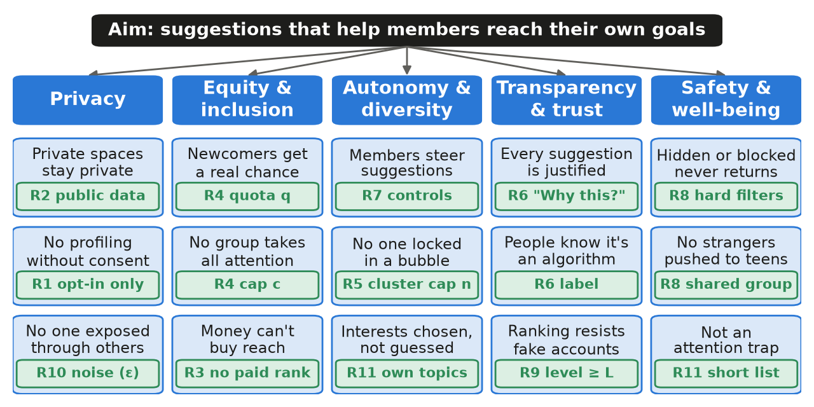
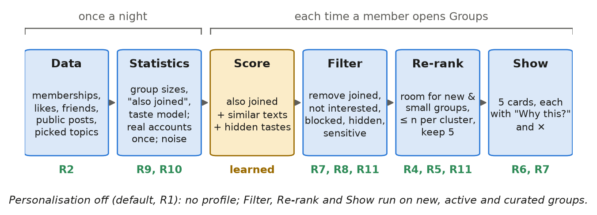

<!--
  Updated interim report, due November 3, 2026. Built on interim-oct27.md (the text of 'Interim report - draft.docx').
  Drafted with Claude (Anthropic) on November 1, 2026: the authors review and rewrite it before submitting.
  Every number comes from a saved file in ../../results/ (named in the table or figure caption):
    t4_baseline.csv, t5_exposure.csv (Section 3.2); e1_methods.csv, e1_methods_ci.csv, e1_price_of_fairness.json,
    hybrid_validation.csv, t9_validation.csv (Sections 2.4 and 3.3).
  E2 to E6 values are left for the final report on purpose.
  Build (from ../build):
    py md2docx.py ../src/interim-nov3.md "../../Interim report - Nov 3 submission.docx" --title "Interim Report" --date "November 3, 2026" --ref-pt 9
    py md2tex.py  ../src/interim-nov3.md ../latex/interim --title "Interim Report" --date "November 3, 2026"
-->

<!-- box -->
# AI-use pre-amble

**System.** Claude (Anthropic), in Claude Code, October 11 to November 2, 2026; this version was drafted with Claude Opus 5.5 [[add the model versions of earlier sessions]].

**Tasks, known limits and corrections.**

1. **Plan and rules.** Proposed our plan, the report outline and a first list of rules. *Limits:* its judgement, not our stakeholders'. *Corrections:* the rules were revised to eleven and the coach cut to a design (Section 4).
2. **References and laws.** Drafted the introduction and references, and checked the DOIs, laws and Montréal numbers against official sources. *Limits:* it can misquote sources; some official pages could not be read automatically. *Corrections:* the check corrected three Montréal numbers and showed that the DSA does not bind BOING (Section 2.2).
3. **Code and results.** Wrote the notebooks: simulator, methods, re-ranker, privacy and fake-account experiments, rule checker and test cases. *Limits:* code can run without doing what its text says; the simulator's rates are arbitrary. *Corrections:* automatic checks and clean re-runs; two reviews in separate Claude sessions, which can share its blind spots, found real problems, since fixed and re-run (Section 4).
4. **Figures.** Drew Figures 1–3 and the charts. *Limits:* a diagram can look tidier than the code. *Corrections:* Figure 3 is marked illustrative; results are quoted from saved files.
5. **Report text.** Drafted this report, including this pre-amble. *Limits:* the wording is its own; it can present a hypothesis as a finding. *Corrections:* every result was copied from a saved file named in the text.
6. **Build tools.** Wrote the scripts that build this report in Word and PDF. *Limits:* conversions can fail silently. *Corrections:* every PDF page was inspected.

[[What we checked or changed ourselves: e.g. re-ran the notebooks, checked the sources, rewrote sections (say which).]]

**Reflection.** Using Claude let us build and test far more than we could have alone in this time, but it also changed what our work was. We spent less time writing code and more time checking whether we understood and agreed with what it produced. For example, while reading the report I realised it had narrowed our project to group suggestions, leaving out the friend and feed suggestions in our plan, without asking me. I also had to ask it to explain ideas like fair re-ranking and the hidden tastes model in simple terms before I could defend them. The biggest lesson for a course on responsible AI is that clean, confident output can still be wrong, as when a review showed that our first privacy setting did not hold up on new tests, so we now treat its work as a draft to question rather than an answer to trust.

# 1. Design Context

Recommender systems shape much of what people see online.
Most of them are tuned for engagement, mainly because engagement is easy to measure, even though it is only a rough stand-in for what people actually value (Kleinberg et al., 2022).
Engagement-driven systems have been linked to filter bubbles (Pariser, 2011) and to popularity bias, where a few items take most of the attention (Abdollahpouri et al., 2017).
They can also create feedback loops that make behaviour more homogeneous (Chaney et al., 2018), and the profiling behind them intrudes on privacy and autonomy (Milano et al., 2020).
Platforms usually add these systems once they are already large.
A new platform has the chance to decide what its recommender is for before building it.

**BOING.** BOING is a free social network where a member's identity is a character rather than a photograph.
Members join groups around personal goals such as languages, coding or exam preparation, plan their week with an AI coach and play games.
They sign up with a username and either an email address or a crypto wallet (email sign-up is being added). No real name is required, and the audience includes teenagers.
BOING already enforces privacy and safety rules (private profiles, blocking, reports, human moderators), but it has no recommender.
Its Discover page ranks groups by member count, so large groups keep growing while new ones stay invisible.

**What we design.** We start with a recommender that suggests groups to join, which is built and tested. For the final report, we are extending the design to suggesting people and to a personalised feed of posts, guided by the same values and rules, and going as deep as time allows.
Its objective is to help members find groups that suit them while keeping new groups visible, protecting privacy by default and resisting fake accounts. This objective and its constraints come from what stakeholders value, not from engagement.
It serves BOING's members, including newcomers and teenagers, but it also affects the groups it ranks and the members whose activity feeds it.

**Deployment assumptions.** Our design rests on seven assumptions:

1. The network is small and young, so popularity bias would lock in early winners.
2. Sign-up needs no real identity. Wallets and ordinary email addresses are cheap to create, so fake ("Sybil") accounts are too, although a verified campus address would make them harder.
3. Members will give a birth year at sign-up, kept private and used only for safety. It is not verified, so suggesting people must be conservative.
4. BOING's mission is helping people reach their goals, not keeping them on the site, so success means a short list of useful suggestions rather than clicks.
5. BOING is subject to Quebec's private-sector privacy act as amended by Law 25 (S.Q. 2021, c. 25).
6. We use no real-user data. We evaluate on a synthetic community and a local copy of BOING with fake members.
7. BOING launches first at McGill, as a campus space inside the wider BOING world, then at other campuses. BOING is independent of the university, and we do not test a campus filter here.

**Approach.** Following value sensitive design (Friedman & Hendry, 2019), we identify the stakeholders, their values and the tensions between them.
We then use the Montréal Declaration (Université de Montréal, 2018) to turn these values into eleven testable design rules.
Some are hard limits that are never traded: personalisation is opt-in, private data is never used, and money cannot buy visibility.
Others are dials that we tune through experiments, namely fair exposure for new groups, diversity, resistance to fake accounts and differential privacy.
We test the design against BOING's current ranking on a synthetic community of 2,000 users and 150 groups, and measure what each value costs in accuracy.
Section 2 presents the design, Section 3 covers the evaluation and our first results, and Section 4 describes our progress and the plan for the final report.

# 2. Design

## 2.1 Stakeholders and values

Following value sensitive design, we list everyone the recommender affects, including indirect stakeholders who never see it, such as members whose memberships shape other people's suggestions (Table 1).
Because we have no real users, the values come from BOING's policies (no paid advantages, private spaces stay private, safety tools for teenagers), published work on recommender harms and our own judgement. Not having a study with real users is a limitation.

<!-- widths: 2.25, 1.15, 3.1 -->
<!-- small -->
Table 1. Stakeholders of the recommender and the values at stake.
| Stakeholder | Type | Values at stake |
|---|---|---|
| Members looking for groups | Direct | Relevance, autonomy (control), privacy, well-being |
| New members; new and small groups | Direct | A fair chance to be seen (equity), belonging |
| Teenage members | Direct, vulnerable | Safety, privacy, not being pushed towards strangers |
| Group owners | Direct | Visibility; protection from manipulation by rivals |
| Members whose data feeds others' suggestions | Indirect | Privacy: not being inferred or exposed through "people like you" |
| Moderators | Indirect | Not amplifying hidden or reported content; a manageable workload |
| Parents and schools | Indirect | Safety, healthy use |
| The platform operator | Indirect | Trust, growth, legal compliance |

These values pull against each other in five places (Table 2).
We call a conflict a *tension* when a careful design can mostly resolve it, and a *trade-off* when gaining one value costs another, so that an experiment has to measure the price.
Rules can conflict as well.
Counting only established accounts (R9) protects group owners from fake accounts, but it also delays the weight of a new member's joins, and experiments E4 and E5 measure both effects.

<!-- widths: 1.55, 0.95, 2.6, 1.4 -->
<!-- small -->
Table 2. Value tensions, how the design serves both sides, and the experiment (Table 5) that settles each one.
| Tension | Kind | How the design serves both | Settled by |
|---|---|---|---|
| Relevance vs fair exposure | Partly a trade-off | Reserve 1–2 of the 5 slots for the most relevant new or small groups, not random ones | E2: accuracy vs newcomer share |
| Personalisation vs privacy | Tension | Opt-in (R1), an allow-list of data (R2), noisy statistics (R10) | E3: accuracy vs ε |
| Transparency vs manipulation | Tension | Explain the kind of reason, not the weights; R9 limits gaming | E4, with reasons shown |
| Discovery vs safety | Tension | People are suggested only through a shared group or friend (R8) | E6: zero violations |
| Engagement vs well-being | Tension | Five suggestions, no endless list, no notifications (R11) | List length; topic match |

## 2.2 From values to design rules

We turn values into rules with a values hierarchy (van de Poel, 2013).
Each value is specified as norms that say what it demands on BOING, and each norm becomes a requirement we can test (Figure 1).
Every rule is traced to the principles and items of the Montréal Declaration (Université de Montréal, 2018).
For R1, we rely on sections 9.1 and 8.1 of Quebec's private-sector act (CQLR c P-39.1), both added by Law 25.
They require "the highest level of confidentiality by default, without any intervention by the person concerned", and they require telling people first that a technology able to profile them is used and how to activate it.
Profiling includes assessing "personal preferences, interests or behaviour", which is what a taste model does.
We read these sections together as support for R1, so profiling stays off until the member switches it on.
This is our own reading, and we have not checked the regulator's guidance.
The EU Digital Services Act (2022) does not bind BOING, since Article 19 exempts small enterprises from Article 27 and Article 38 covers only very large platforms.
We still follow it voluntarily.
R6 and R7 aim at Article 27, and R1 goes further than Article 38 by making the option without profiling the default.

We take a pluralist stance.
Seven rules are hard limits that are never traded and are tested to zero violations.
These cover the safety filters, the privacy of private spaces and the ban on paying for reach.
The other four are dials whose settings come from the experiments, and the Discussion of the final report will defend them (Table 3).
This follows the Declaration itself, whose principles are not ranked but limit one another: "the limits of one principle's application are defined by another principle's field of application" (p. 5).

**Social and policy implications.** Socially, the design gives new groups a fair chance of being seen, and it limits who can be reached through suggestions. On policy, it treats privacy by default as a requirement under Quebec law, and it follows the Digital Services Act as a voluntary benchmark.

{width=4.7}

<!-- widths: 0.55, 2.95, 0.92, 0.78, 1.3 -->
<!-- small -->
Table 3. The design rules. Hard rules are never traded; dial rules are tuned by the experiments. Montréal numbers are principle.item of the Declaration (Université de Montréal, 2018); "Law 25" means sections 8.1 and 9.1 of Quebec's private-sector act.
| Rule | What the recommender must do | Values | Montréal | Passes when |
|---|---|---|---|---|
| **R1** Hard | Opt-in: personalised suggestions are off until a member turns them on. With them off, the page still lists new, active and curated groups. | Privacy, autonomy | 3.4, 3.6; Law 25 | New accounts start off; the off list is never empty |
| **R2** Hard | Allow-list: only public, on-platform signals (memberships, likes, friendships, public posts, group descriptions, topics a member picked). Never messages, planner, coach chats, purchases, wallets, email addresses or birth years. | Privacy | 3.1, 3.2, 8.4 | Changing a member's private data changes nothing in their suggestions |
| **R3** Hard | No paying for reach: tokens, purchases and ads never change the ranking; ads stay a separate, labelled slot. | Equity, trust | 6.2 | A group's spending does not move its rank |
| **R4** Dial q, c | Fair exposure: at least q% of all slots go to new (30 days or less) or small (under 10 members) groups; no group takes more than c% of all slots. | Equity, inclusion | 6.2, 6.3, 7.1 | Newcomer share ≥ q; largest share ≤ c; Gini reported |
| **R5** Dial n, λ | Diversity: at most n of the 5 suggestions share a topic; similar groups are spread out. | Autonomy, diversity | 7.1, 7.4 | No list breaks n |
| **R6** Hard | Honest reasons: each suggestion shows its main true reason from a fixed template and is labelled as made by an algorithm. A friend is named only if their profile is public. | Transparency, privacy | 5.2, 5.7, 5.8 | Explanation fidelity is 100% |
| **R7** Hard | Members steer: "Not interested", hide a topic, reset, see what is used. The system only suggests; it never joins or messages anyone for a member. | Autonomy | 2.1, 3.4, 3.6, 9.2 | Hidden items never return; reset clears everything |
| **R8** Hard | Safety filters: never suggest blocked, suspended or private accounts, or anything hidden by moderators or reports. People only through a shared group or a friend of a friend. | Safety | 1.5, 3.1, 4.1, 8.3 | Zero violations on the test cases |
| **R9** Dial L, w | Fake-account resistance: only established accounts (level L or more) count, each once; joins by accounts younger than 30 days count less (weight w). | Trust, fairness | 8.3, 6.2 | Places a target group climbs per fake account |
| **R10** Dial ε, m | Differential privacy: statistics about other members get calibrated noise, and each member counts for at most m groups. | Privacy | 3.5, 8.4 | Accuracy at each ε (privacy–utility curve) |
| **R11** Hard | Well-being: five suggestions, no endless scroll, no notifications. Topic matching uses only topics members chose, never topics inferred from their activity. | Well-being, autonomy | 1.5, 2.6, 3.3 | Lists have 5 items; no inferred topics used |

The experiments sweep each dial: q ∈ {0, 20, 40, 60}% and c ∈ {5%, 10%, no cap} for R4; n ∈ {2, 3, 5} and the variety weight λ ∈ {0.5, 0.7, 0.8, 0.9, 1} for R5; L ∈ {1, 3, 5} and w ∈ {0, 1} for R9; and ε ∈ {0.1, 0.5, 1, 2, 5, ∞} with m ∈ {3, 5, 8} for R10.
Three choices are fixed rather than tuned: five suggestions, "new" means created in the last 30 days, and "small" means fewer than 10 members.

## 2.3 The system

Figure 2 shows how a suggestion is made.
Once a night, BOING reads only the allowed data (R2) and computes every statistic about other members in one place, so the rules about whose data counts (R8–R10) reach every score at once.
When a member who has switched personalisation on opens the Groups page, the candidate groups are scored, filtered (R7, R8) and re-ranked (R4, R5), and five suggestions are shown with their reasons (R6).
Only the scoring step is learned.
Every ethical guarantee sits in fixed, testable steps around it, so changing the model cannot break a hard rule.
By default personalisation is off, so no profile is used, and the same filtering and re-ranking apply to new and active groups (R1).
Table 4 shows how our prototype builds each step.
A rule checker counts every hard-rule violation, and we plant faults on purpose to show that each check can fire.
The chosen design will run on a local test copy of BOING with fake members only.

{width=5.2}

<!-- widths: 1.1, 4.3, 1.1 -->
<!-- small -->
Table 4. How the prototype enforces the rules at each step of Figure 2, and where each step stands on November 1.
| Step (rules) | How the prototype does it | Status |
|---|---|---|
| Data (R2, R3) | Only the allowed tables reach the recommender. A check alters private data and paid budgets and confirms that no list changes. | Built |
| Statistics (R8–R10) | One function makes every count about other members: no suspended accounts; only level L or more, once each, young ones with weight w; at most m groups per member; Laplace noise for ε. | Built; re-checked |
| Filter (R7, R8) | Open, unhidden Discover groups the member has not joined or dismissed; a friend counts only with a public profile and no block. | Built |
| Re-rank (R4, R5, R11) | Greedy, slot by slot: quota q, cap c, at most n groups per topic cluster, variety λ; five slots. | Built; dials fixed |
| Show (R6, R7) | One template reason each: the part that adds most to the score, or "a fair chance" for a quota slot. "Not interested" is permanent. | Built; more controls planned |
| Off, the default (R1) | No profile: recent activity and newness, then the same filter and re-ranking. | Built |

## 2.4 The algorithms

We built the scoring step up from the simplest method, so that each addition has to beat the simpler ones.
Learned methods see only the training data, and every setting is chosen on a validation split of it, never on the test set (Section 3.1).
Besides popularity, our baseline, we compare:

- *"Also joined"*, item-to-item collaborative filtering (Sarwar et al., 2001): a group scores by its member overlap (Jaccard) with each of the member's groups, which gives reasons such as "4 members of X are in it".
- *Similar descriptions*: the TF-IDF similarity of a group's description to those of the member's groups. It needs no members, so it reaches new groups.
- *Hidden tastes*, our AI model: a truncated SVD of the member × group matrix (Koren et al., 2009) with 10 tastes, chosen on the validation split; on 0/1 join data with no missing entries, plain SVD is a reasonable first model. Its tastes line up with the hidden topics it never sees. Because it profiles members, it is opt-in (R1).
- *Friends*: how many of the member's friends with a public profile are in the group.
- The *hybrid* rescales each score to 0–1 over the member's candidates and mixes them with weights chosen on the validation split among 286 mixes: 0.4 "also joined", 0.1 descriptions, 0.3 friends and 0.2 hidden tastes. The best mixes differ by thousandths; the final design re-chooses them with the privacy noise on.
- The *fair re-ranker* fills each list one slot at a time, trading relevance against similarity to the groups already picked (λ; Carbonell & Goldstein, 1998), with quota q, cap c and at most n groups per topic cluster (clusters of the descriptions, since the hidden topics may not be read).

The re-ranker applies the idea of fairness of exposure: a ranking shares out attention, and that share can be held to a standard (Singh & Joachims, 2018).
Like them, we keep fairness to groups (R4) separate from variety for the member (R5).
For R10, each member counts for at most m groups, and Laplace noise calibrated to ε is added to the group sizes and pair counts (Dwork & Roth, 2014).
"Also joined" and the taste model both come from these counts, so one noisy release protects both (McSherry & Mironov, 2009).
Public signals are not covered, and the final report will state the guarantee's exact scope.
R9 is our defence against Sybil attacks (Douceur, 2002), which push little-known items most easily (Lam & Riedl, 2004).
Tournesol takes a similar approach by counting only trusted accounts (Hoang et al., 2021).
Each reason is meant to support transparency and scrutability (Tintarev & Masthoff, 2007), not persuasion.

## 2.5 The interface

Figure 3 sketches the new Groups page.
With personalisation off, every member sees the same list of new and active groups.
With it on, the five suggestions are labelled as made by an algorithm, and each shows its reason and can be dismissed (R6, R7).
We will build it on the local test copy of BOING (Section 4).

{width=3.5}

# 3. Evaluation Plan and First Results

## 3.1 A synthetic community

We evaluate on synthetic data only, so no member's data is collected.
A simulator generates 2,000 users and 150 groups across 10 topics, such as exam preparation, languages and coding.
Each user has hidden interests in 1 to 3 topics and each group a hidden topic.
Joins happen in time order. In 88% of cases they go to a user's favourite topics and otherwise they are random, and either way bigger groups are more likely to be picked.
This "rich get richer" rule reproduces the long tail of real platforms. The ten largest groups hold 35% of all memberships, while 64 groups have fewer than 10 members.
Fifteen percent of users and 20% of groups are new.
Blocks, suspended accounts and three groups hidden by moderators let us test the safety rules.
The hidden interests and topics act as the answer key, and only the scoring code reads them.
These rates are our assumptions about behaviour, not measurements, and a fixed random seed makes every result reproducible.
Table 5 lists the experiments we run on it, and where each stands.

<!-- widths: 0.35, 2.65, 1.85, 0.75, 0.9 -->
<!-- small -->
<!-- keep -->
Table 5. The experiments, and where each stands on November 1.
| # | Question | What we measure | Rules | Status |
|---|---|---|---|---|
| E1 | Which scoring method works best, with and without fair re-ranking? | Relevance, exposure, diversity | All | Done (Section 3.3) |
| E2 | What do fair exposure and variety cost (q, c, n, λ)? | NDCG@5 against newcomer share | R4, R5 | Done; values in the final report |
| E3 | What does privacy cost (ε, m)? Opted-in members only against everyone | NDCG@5 against ε | R10 | Re-checked; values in the final report |
| E4 | Can 0.5–10% fake accounts of four kinds push a small new group up? | Lists showing the target; places gained per fake | R9 | Re-checked; values in the final report |
| E5 | Do new members and new groups get a fair deal? | NDCG@5 by groups joined; new groups' exposure | R4, R9 | Done; values in the final report |
| E6 | Do the hard rules hold? | Violations (target 0); faithful reasons (100%); planted faults caught | R1–R3, R6–R8, R11 | Done; values in the final report |

**Test set and metrics.** For the 1,406 users with at least three groups, we hide 20% of their memberships (at least one).
This gives 1,531 hidden memberships for the test set and leaves 6,428 visible, and we remove any posts or likes that would reveal a hidden membership.
To choose settings, we hide 20% of the visible memberships again in the same way, which keeps the test set for reporting only.
Each method gives each user five suggestions.
Relevance is measured with the hit rate (the share of users for whom at least one suggestion is a hidden group), precision@5, recall@5 and NDCG@5, which gives more credit to a correct group ranked higher (Järvelin & Kekäläinen, 2002).
Fair exposure (R4) is the share of slots that go to new or small groups, alongside the Gini coefficient of exposure and the number of groups ever shown.
Diversity (R5) is the number of topics per list.

## 3.2 First results: today's ranking

We scored BOING's current ranking on the test set (the largest open groups not hidden by moderators, minus the user's own groups), with five random groups per user as a floor.
Ranking by size beats chance by more than a factor of four: 22% of users find a hidden group among their five suggestions, against 5% with random suggestions, and NDCG@5 is 0.131 (t4_baseline.csv; Table 6).
The cost shows in who gets seen.
Because everyone receives the same ranking, only 10 of the 129 groups on Discover were ever suggested to the 1,406 users, and none of the 53 new or small groups appeared.
The newcomer share is 0% and the Gini coefficient of exposure is 0.953 (t5_exposure.csv).
Relevance suffers as well.
User 1, who studies for exams, is offered large groups on weightlifting, Japanese, Spanish and algorithms, and none of them is correct.
This is the popularity bias described in Section 1. It sets the relevance that every method in E1 must beat, and the 0% newcomer share that R4 must raise.

## 3.3 First results: comparing the methods (E1)

In Table 6, "also joined" (NDCG@5 0.499) and the AI model (0.475) beat today's ranking (0.131) by a wide margin.
The hybrid is the most relevant (0.541), although its 95% range overlaps that of "also joined".
However, the accurate methods give new or small groups almost no slots (0.5% to 2.7%).
They learn from memberships, which such groups lack, so accuracy alone brings popularity bias back in a milder form.
Similar descriptions needs no members and gives them 41.6% of its slots, but it is weak on relevance (0.159).

The fair re-ranker fixes this at a small cost.
New or small groups get 20.3% of the slots, 125 of the 129 Discover groups are shown, and the Gini coefficient of exposure falls to 0.511 (0.640 for the hybrid and 0.953 for popularity).
Its NDCG@5 is 0.528, so the price of fairness is 0.0126 NDCG@5 per user on average, 2.3% of the hybrid's (paired 95% range 0.008 to 0.017; e1_price_of_fairness.json).
The default list, with no profile (R1), is far less relevant (0.058, against 0.025 for random) and shows only 14 groups, since every member sees nearly the same list.
This is the price of not profiling anyone.
E1 makes the hybrid with fair re-ranking our design, and E2 to E5 tune its dials and add the privacy noise and the fake-account defence.

<!-- widths: 2.25, 0.75, 1.45, 1.1, 0.8, 0.8 -->
<!-- keep -->
Table 6. First comparison of the methods on the test set (E1; 1,406 users). Re-ranker: q = 20%, c = 10%, n = 2, λ = 1. 95% ranges from resampling the users; groups shown, of the 129 on Discover. Source: results/e1_methods.csv, e1_methods_ci.csv.
| Method | Hit rate | NDCG@5 (95% range) | Slots for new or small groups | Gini of exposure | Groups shown |
|---|---:|---:|---:|---:|---:|
| Random (floor) | 0.048 | 0.025 (0.019–0.033) | 41.7% | 0.079 | 129 |
| Popularity (BOING today) | 0.220 | 0.131 (0.117–0.146) | 0% | 0.953 | 10 |
| "Also joined" | 0.640 | 0.499 (0.476–0.522) | 2.7% | 0.599 | 94 |
| Similar descriptions | 0.263 | 0.159 (0.144–0.176) | 41.6% | 0.502 | 125 |
| Hidden tastes (AI model) | 0.610 | 0.475 (0.452–0.496) | 0.5% | 0.645 | 76 |
| Hybrid | 0.687 | 0.541 (0.517–0.563) | 2.0% | 0.640 | 106 |
| **Hybrid + fair re-ranking** | **0.656** | **0.528 (0.504–0.551)** | **20.3%** | **0.511** | **125** |
| Personalisation off (default) | 0.098 | 0.058 (0.048–0.068) | 54.7% | 0.921 | 14 |

# 4. Progress and Plan to the Final Report

The Design is complete, the prototype implements all of Figure 2 (Table 4), and E1 to E6 have all been run. This report gives the E1 results.
Two code reviews (separate Claude sessions) found problems in how "small" groups are counted and in what R9 and the privacy noise cover. We fixed them and re-ran the affected results, and the final report will give the values for E2 to E6.
Test cases are ready for the port to BOING's local test copy (Table 7).

<!-- widths: 0.9, 4.85, 0.75 -->
<!-- small -->
Table 7. Progress and plan.
| When | Work | Status |
|---|---|---|
| Oct 11–27 | Synthetic community, test set, baseline; stakeholders, values, design rules R1–R11, system design | Done |
| Oct 28 – Nov 1 | Baseline exposure; the four scores, the hybrid and the fair re-ranker; E1; E2–E6; rule checker and test cases; two code reviews and their fixes; every dial fixed | Done |
| Nov 2–15 | Extend the design to suggesting people and a personalised feed of posts, with the same values and rules, as far as time allows | Starting |
| Nov 10–16 | Build the chosen design on BOING's local test copy and check it against the test cases; "before" and "after" screens | Planned |
| Nov 17–24 | Final report (Results, Discussion of the dials and stakeholders, Conclusion, a model card after Mitchell et al., 2019); slides, video; presentation Nov 24, 26 or Dec 1 | Planned |

**Expected results.** By the final report, the prototype will give each member who opts in five group suggestions with their reasons, and a default list with no profile to everyone else, running on a local test copy of BOING with fake members. We will assess it by its relevance against today's ranking (hit rate and NDCG@5), the share of slots that go to new or small groups, the Gini coefficient of exposure, zero hard-rule violations, and what each rule costs in accuracy. We expect it to stay well above today's ranking in relevance while giving new or small groups about 20% of the slots.

**Scope.** A privacy layer for BOING's AI coach was planned as a second part. The TA warned that doing both would be a lot of work, so it becomes a design and audit in the final Discussion, with no code.
**Known limitations.** Synthetic data encode our own assumptions, so we trust the trade-offs more than the absolute numbers.
Relevance here means rejoining a hidden group, not being satisfied with it.
The values come from documents and our judgement rather than interviews.
Ages are unverified, so teen protections apply to everyone.

# References

Abdollahpouri, H., Burke, R., & Mobasher, B. (2017). Controlling popularity bias in learning-to-rank recommendation. In *Proceedings of the Eleventh ACM Conference on Recommender Systems* (pp. 42–46). Association for Computing Machinery. https://doi.org/10.1145/3109859.3109912

Act respecting the protection of personal information in the private sector, CQLR c P-39.1, ss. 8.1, 9.1 (consolidated to October 15, 2026). https://www.legisquebec.gouv.qc.ca/en/document/cs/P-39.1

An Act to modernize legislative provisions as regards the protection of personal information, S.Q. 2021, c. 25 (assented to September 22, 2021). https://www.assnat.qc.ca/en/travaux-parlementaires/projets-loi/projet-loi-64-42-1.html

Carbonell, J., & Goldstein, J. (1998). The use of MMR, diversity-based reranking for reordering documents and producing summaries. In *Proceedings of the 21st Annual International ACM SIGIR Conference on Research and Development in Information Retrieval* (pp. 335–336). Association for Computing Machinery. https://doi.org/10.1145/290941.291025

Chaney, A. J. B., Stewart, B. M., & Engelhardt, B. E. (2018). How algorithmic confounding in recommendation systems increases homogeneity and decreases utility. In *Proceedings of the 12th ACM Conference on Recommender Systems* (pp. 224–232). Association for Computing Machinery. https://doi.org/10.1145/3240323.3240370

Douceur, J. R. (2002). The Sybil attack. In P. Druschel, F. Kaashoek, & A. Rowstron (Eds.), *Peer-to-peer systems: First International Workshop, IPTPS 2002* (Lecture Notes in Computer Science, Vol. 2429, pp. 251–260). Springer. https://doi.org/10.1007/3-540-45748-8_24

Dwork, C., & Roth, A. (2014). The algorithmic foundations of differential privacy. *Foundations and Trends in Theoretical Computer Science, 9*(3–4), 211–407. https://doi.org/10.1561/0400000042

Friedman, B., & Hendry, D. G. (2019). *Value sensitive design: Shaping technology with moral imagination*. MIT Press. https://doi.org/10.7551/mitpress/7585.001.0001

Hoang, L.-N., Faucon, L., Jungo, A., Volodin, S., Papuc, D., Liossatos, O., Crulis, B., Tighanimine, M., Constantin, I., Kucherenko, A., Maurer, A., Grimberg, F., Nitu, V., Vossen, C., Rouault, S., & El-Mhamdi, E.-M. (2021). *Tournesol: A quest for a large, secure and trustworthy database of reliable human judgments* (arXiv:2107.07334). arXiv. https://doi.org/10.48550/arXiv.2107.07334

Järvelin, K., & Kekäläinen, J. (2002). Cumulated gain-based evaluation of IR techniques. *ACM Transactions on Information Systems, 20*(4), 422–446. https://doi.org/10.1145/582415.582418

Kleinberg, J., Mullainathan, S., & Raghavan, M. (2022). The challenge of understanding what users want: Inconsistent preferences and engagement optimization. In *Proceedings of the 23rd ACM Conference on Economics and Computation* (p. 29). Association for Computing Machinery. https://doi.org/10.1145/3490486.3538365

Koren, Y., Bell, R., & Volinsky, C. (2009). Matrix factorization techniques for recommender systems. *Computer, 42*(8), 30–37. https://doi.org/10.1109/MC.2009.263

Lam, S. K., & Riedl, J. (2004). Shilling recommender systems for fun and profit. In *Proceedings of the 13th International Conference on World Wide Web* (pp. 393–402). Association for Computing Machinery. https://doi.org/10.1145/988672.988726

McSherry, F., & Mironov, I. (2009). Differentially private recommender systems: Building privacy into the Netflix Prize contenders. In *Proceedings of the 15th ACM SIGKDD International Conference on Knowledge Discovery and Data Mining* (pp. 627–636). Association for Computing Machinery. https://doi.org/10.1145/1557019.1557090

Milano, S., Taddeo, M., & Floridi, L. (2020). Recommender systems and their ethical challenges. *AI & Society, 35*(4), 957–967. https://doi.org/10.1007/s00146-020-00950-y

Mitchell, M., Wu, S., Zaldivar, A., Barnes, P., Vasserman, L., Hutchinson, B., Spitzer, E., Raji, I. D., & Gebru, T. (2019). Model cards for model reporting. In *Proceedings of the Conference on Fairness, Accountability, and Transparency* (pp. 220–229). Association for Computing Machinery. https://doi.org/10.1145/3287560.3287596

Pariser, E. (2011). *The filter bubble: What the Internet is hiding from you*. Penguin Press.

Regulation (EU) 2022/2065 of the European Parliament and of the Council of 19 October 2022 on a Single Market For Digital Services and amending Directive 2000/31/EC (Digital Services Act). (2022). *Official Journal of the European Union*, L 277, 1–102. https://eur-lex.europa.eu/eli/reg/2022/2065/oj

Sarwar, B., Karypis, G., Konstan, J., & Riedl, J. (2001). Item-based collaborative filtering recommendation algorithms. In *Proceedings of the 10th International Conference on World Wide Web* (pp. 285–295). Association for Computing Machinery. https://doi.org/10.1145/371920.372071

Singh, A., & Joachims, T. (2018). Fairness of exposure in rankings. In *Proceedings of the 24th ACM SIGKDD International Conference on Knowledge Discovery & Data Mining* (pp. 2219–2228). Association for Computing Machinery. https://doi.org/10.1145/3219819.3220088

Tintarev, N., & Masthoff, J. (2007). A survey of explanations in recommender systems. In *2007 IEEE 23rd International Conference on Data Engineering Workshop* (pp. 801–810). IEEE. https://doi.org/10.1109/ICDEW.2007.4401070

Université de Montréal. (2018). *Montréal Declaration for a responsible development of artificial intelligence*. https://declarationmontreal-iaresponsable.com/wp-content/uploads/2023/04/UdeM_Decl-IA-Resp_LA-Declaration-ENG_WEB_09-07-19.pdf

van de Poel, I. (2013). Translating values into design requirements. In D. P. Michelfelder, N. McCarthy, & D. E. Goldberg (Eds.), *Philosophy and engineering: Reflections on practice, principles and process* (pp. 253–266). Springer. https://doi.org/10.1007/978-94-007-7762-0_20
