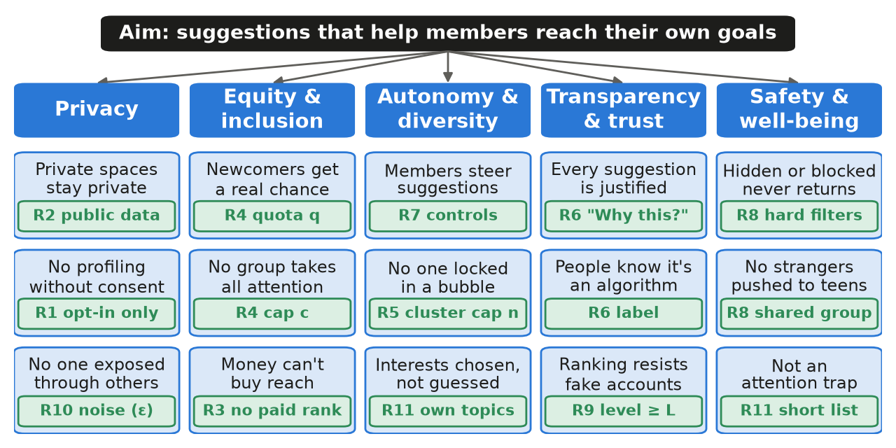
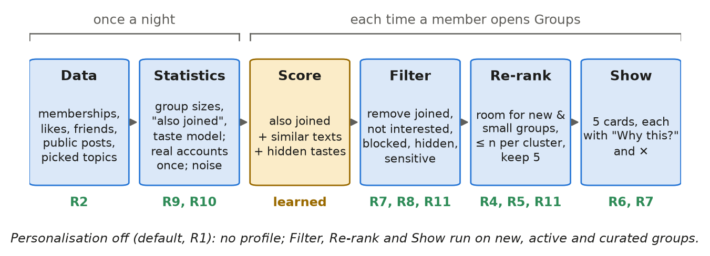

<!--
  Interim report as of October 27, 2026 (the text of 'Interim report - draft.docx'), in the report's
  Markdown subset. Build it with the tools in ../build (see ../build/README.md):
    py ../build/md2docx.py interim-oct27.md out.docx --title "Interim Report" --date "November 3, 2026"
    py ../build/md2tex.py  interim-oct27.md outdir   --title "Interim Report" --date "November 3, 2026"
-->

<!-- box -->
# AI-use statement

We used Claude (Anthropic), through the Claude Code assistant, in three ways. **Writing:** it proposed the outline
of this report and drafted parts of every section, which we [[reviewed and rewrote in our own words]]. **Code:** it
wrote the Python notebooks that generate the synthetic community, split it into training and test data and score
the baseline (Section 3), and the script that draws Figures 1 to 3; we read every cell, re-ran the notebooks and
checked their outputs with the automatic checks they contain [[add anything else you checked or changed]].
**Planning:** it compiled our planning notes, including a first list of design rules that we then discussed and
revised. Its known limits are that it can cite sources or article numbers inaccurately and can write code that
runs but does not do what was intended, so we checked every reference and every Montréal Declaration article
against the original texts [[confirm]]. A dated log of each use, with what we checked, is kept in our repository
(AI-USE-LOG.md).

# 1. Design Context

Recommender systems decide much of what people see online: which posts appear first, which video plays next,
which communities they are invited to join. Most are optimised for engagement, such as clicks or time spent,
because engagement is easy to measure. But engagement is only a proxy for what people value, and the two can
diverge (Kleinberg et al., 2022). Engagement-driven recommenders have been linked to filter bubbles that narrow
what people encounter (Pariser, 2011). They are also linked to popularity bias, in which a few items capture most
of the attention while new ones are rarely shown (Abdollahpouri et al., 2017), and to feedback loops that make
users' behaviour more homogeneous (Chaney et al., 2018). Finally, the profiling they rely on intrudes on privacy
and autonomy (Milano et al., 2020). Such systems are usually added once a platform is large and its incentives are
fixed. A new platform has a rarer opportunity: to decide what its recommender is for before building it.

**BOING.** BOING (boingfrog.com) is a free social network, where a member's identity is a character rather than a
photograph. Members join groups around personal goals such as languages, coding or exam preparation, plan their
week with an AI coach and play games. They sign in with a crypto wallet and a username, without an email address
or real name, and the audience includes teenagers. BOING already enforces privacy and safety rules (private
profiles, blocking, reports, human moderators), but it has no recommender. Its Discover page ranks groups by member
count, so large groups keep growing while new ones stay invisible.

**What we design.** We design a recommender that suggests groups to join, with people and an optional personalised
feed as extensions. Its objective and constraints come from its stakeholders' values rather than from engagement.
It serves BOING's members, including newcomers and teenagers, and it also affects the groups it ranks and the
members whose activity feeds it.

**Deployment assumptions.** Our design rests on six assumptions:

1. The network is small and young, so most members and groups have little history, and popularity bias would lock
   in early winners.
2. Sign-up is pseudonymous, so fake ("Sybil") accounts are cheap and could manipulate rankings.
3. Members' ages are unknown, so suggesting people must be conservative.
4. BOING's mission is reaching goals, not time on site, so success means a short list of useful suggestions, not
   clicks.
5. BOING is subject to Quebec's Law 25, which requires privacy-protective defaults and notice of profiling
   (Quebec, 2021).
6. No real-user data is used: we evaluate on a synthetic community and demonstrate the design on a local copy of
   BOING with fake members.

**Approach.** Following value sensitive design (Friedman & Hendry, 2019), we identify the stakeholders, their values
and the tensions between them. We then use the Montréal Declaration (2018) to turn these values into eleven
testable design rules. Some are hard limits that are never traded: personalisation is opt-in, private data is
never used, and money cannot buy visibility. Others are adjustable and tuned in experiments: fair exposure for new
groups, diversity, resistance to fake accounts and differential privacy. We will evaluate the design on a
synthetic community of 2,000 users and 150 groups against BOING's current ranking, and measure what each value
costs in accuracy. Section 2 presents the design, Section 3 the evaluation plan and our first results, and
Section 4 our progress and the plan to the final report.

# 2. Design

## 2.1 Stakeholders and values

Following value sensitive design, we list everyone the recommender affects, including indirect stakeholders who
never see it, such as members whose memberships shape other people's suggestions (Table 1). Because we have no
real users, the values come from BOING's existing policies (no paid advantages, private spaces stay private, safety
tools for teenagers), from published work on the harms of recommenders, and from our own judgement as designers; a
study with real users is outside this project and will be reported as a limitation.

<!-- widths: 2.25, 1.15, 3.1 -->
Table 1. Stakeholders of the recommender and the values at stake.
| Stakeholder | Type | Values at stake |
|---|---|---|
| Members looking for groups | Direct | Relevance, autonomy (control), privacy, well-being |
| New members; new and small groups | Direct | A fair chance to be seen (equity), belonging |
| Teenage members | Direct, vulnerable | Safety, privacy, not being pushed towards strangers |
| Group owners | Direct | Visibility; protection from manipulation by rivals |
| Members whose data feeds others' suggestions | Indirect | Privacy: not being inferred or exposed through "people like you" |
| Moderators | Indirect | Not amplifying hidden or reported content; a manageable workload |
| Parents and schools | Indirect | Safety, healthy use |
| The platform operator | Indirect | Trust, growth, legal compliance |

These values pull against each other in five places (Table 2). We label each one a *tension*, which a careful
design can largely resolve, or a *trade-off*, where gaining one value costs another and an experiment will measure
the price. Rules can also conflict: counting only established accounts (R9) protects group owners from fake
accounts but delays the weight of a new member's joins; experiments E4 and E5 measure both effects.

<!-- widths: 1.55, 0.95, 2.6, 1.4 -->
Table 2. Value tensions, how the design serves both sides, and the experiment (Section 3) that settles each one.
| Tension | Kind | How the design serves both | Settled by |
|---|---|---|---|
| Relevance vs fair exposure | Partly a trade-off | Reserve 1–2 of the 5 slots for the most relevant new or small groups, not random ones | E2: accuracy vs newcomer share |
| Personalisation vs privacy | Tension | Opt-in (R1), an allow-list of data (R2), noisy statistics (R10) | E3: accuracy vs ε |
| Transparency vs manipulation | Tension | Explain the kind of reason, not the weights; R9 limits gaming | E4, with reasons shown |
| Discovery vs safety | Tension | People are suggested only through a shared group or friend (R8) | E6: zero violations |
| Engagement vs well-being | Tension | Five suggestions, no endless list, no notifications (R11) | List length; topic match |

## 2.2 From values to design rules

We turn values into rules with a values hierarchy (van de Poel, 2013): each value is specified as norms that say
what it demands on BOING, and each norm becomes a design requirement that can be tested (Figure 1). Every rule is
traced to an article of the Montréal Declaration (2018). Rule R1 also follows Quebec's Law 25, which requires
privacy settings to offer the highest level of confidentiality by default and people to be told when a technology
that can profile them is used (sections 9.1 and 8.1 of the private-sector privacy act, as amended). Our stance is
pluralist. Seven rules are hard limits, never traded and tested to zero violations: the safety filters, the
privacy of private spaces and the ban on paying for reach. Four are dials whose settings the experiments will
choose and the Discussion will defend (Table 3). This follows the Declaration itself, whose principles are not
ranked but bound one another: "the limits of one principle's application are defined by another principle's field
of application" (p. 5).

{width=6.2}

<!-- widths: 0.55, 2.95, 0.92, 0.78, 1.3 -->
<!-- small -->
Table 3. The design rules. Hard rules are never traded; dial rules are tuned by the experiments. Montréal numbers are articles of the Declaration (2018).
| Rule | What the recommender must do | Values | Montréal | Passes when |
|---|---|---|---|---|
| **R1** Hard | Opt-in: personalised suggestions are off until a member turns them on. With them off, the page still lists new, active and curated groups. | Privacy, autonomy | 3.4, 3.6; Law 25 | New accounts start off; the off list is never empty |
| **R2** Hard | Allow-list: only public, on-platform signals (memberships, likes, friendships, public posts, group descriptions, topics a member picked). Never messages, planner, coach chats, purchases or wallets. | Privacy | 3.1, 3.2, 8.4 | Changing a member's private data changes nothing in their suggestions |
| **R3** Hard | No paying for reach: tokens, purchases and ads never change the ranking; ads stay a separate, labelled slot. | Equity, trust | 6.2 | A group's spending does not move its rank |
| **R4** Dial q, c | Fair exposure: at least q% of all slots go to new (30 days or less) or small (under 10 members) groups; no group takes more than c% of all slots. | Equity, inclusion | 6.2, 6.3, 7.1 | Newcomer share ≥ q; largest share ≤ c; Gini reported |
| **R5** Dial n | Diversity: at most n of the 5 suggestions share a topic. | Autonomy, diversity | 7.1, 7.4 | No list breaks n |
| **R6** Hard | Honest reasons: each suggestion shows its main true reason from a fixed template and is labelled as made by an algorithm. A friend is named only if their profile is public. | Transparency, privacy | 5.2, 5.7, 5.8 | Explanation fidelity is 100% |
| **R7** Hard | Members steer: "Not interested", hide a topic, reset, see what is used. The system only suggests; it never joins or messages anyone for a member. | Autonomy | 2.1, 3.6, 9.1 | Hidden items never return; reset clears everything |
| **R8** Hard | Safety filters: never suggest blocked, suspended or private accounts, or anything hidden by moderators or reports. People only through a shared group or a friend of a friend. | Safety | 1.5, 2.5, 8.3 | Zero violations on the test cases |
| **R9** Dial L | Fake-account resistance: only established accounts (level L or more) count, each once; sudden bursts of joins count less. | Trust, fairness | 8.1 | Places a target group climbs per fake account |
| **R10** Dial ε | Differential privacy: statistics about other members get calibrated noise, and each member's contribution is capped. | Privacy | 3.5, 8.4 | Accuracy at each ε (privacy–utility curve) |
| **R11** Hard | Well-being: five suggestions, no endless scroll, no notifications. Topic matching uses only topics members chose, never topics inferred from their activity. | Well-being, autonomy | 1.5, 2.6, 3.3 | Lists have 5 items; no inferred topics used |

The dials and the settings we will try are q ∈ {0, 20, 40}% and c ∈ {5%, 10%, no cap} for R4, n ∈ {2, 3, 5} for
R5, L ∈ {1, 3, 5} for R9 and ε ∈ {0.1, 0.5, 1, 2, 5, ∞} for R10. Three choices are fixed rather than tuned: five
suggestions, "new" means created in the last 30 days, and "small" means fewer than 10 members.

## 2.3 The system

Figure 2 shows how a suggestion is made. Once a night, BOING reads only the allowed data (R2) and computes what the
recommender needs: group sizes, how often groups are joined together, and the taste model, counting established
accounts once each (R9) and adding noise (R10). Each time a member who has switched personalisation on opens the
Groups page, the groups are scored, everything the member must not see is removed (R7, R8), the list is re-ranked
to make room for new and small groups and to mix topics (R4, R5), and five suggestions are shown, each with its
reason (R6). Only the scoring step uses machine learning. Every ethical guarantee sits in fixed, testable steps
around it, so a change to the model cannot break a hard rule. With personalisation off, the default, no profile is
used: the same filtering and re-ranking apply to new, active and curated groups, so the page stays useful without
profiling (R1). The chosen design will run on a local test copy of BOING with fake members only, never on the live
site.

{width=6.2}

## 2.4 The algorithms

We build the scoring step from the simplest method upwards, so each addition has to beat the simpler ones, and
every learned method sees only the training data (Section 3.1). The methods are: (0) *popularity*, BOING's current
ranking and our baseline; (1) *"also joined"*, item-to-item collaborative filtering that scores a group by how much
its members overlap with those of the member's groups (Sarwar et al., 2001), which gives reasons such as "4 members
of X are in it"; (2) *similar descriptions*, the TF-IDF similarity of group descriptions to the member's groups and
chosen topics, which works for new groups with no members yet; (3) *hidden tastes*, matrix factorisation
(truncated SVD) of the member × group matrix (Koren et al., 2009), our AI model, often the most accurate but the
hardest to explain; and (4) a weighted *hybrid* of 1–3. Around the scoring step, a greedy re-ranker trades
relevance against similarity to the groups already picked (Carbonell & Goldstein, 1998) while reserving q% of slots
for new or small groups and allowing at most n per topic (R4, R5). Each member's contribution to the counts is
capped and Laplace noise calibrated to ε is added (Dwork & Roth, 2014; R10). Only accounts at level L or above
count, once each, against Sybil attacks (Douceur, 2002; R9). Each reason shown is the largest contributor to the
score, written from a fixed template, never generated text (R6).

## 2.5 The interface

Figure 3 sketches the new Groups page. With personalisation off, every member sees the same list of new and active
groups. With it on, the five suggestions are labelled as made by an algorithm, and each shows its reason and can be
dismissed (R6, R7). We will build it on the local test copy of BOING once the experiments have fixed the dials.

{width=5.6}

# 3. Evaluation Plan and First Results

## 3.1 A synthetic community

We evaluate on synthetic data only, so no member's data is collected. A simulator generates 2,000 users and 150
groups across 10 topics, such as exam preparation, languages and coding. Each user has hidden interests in 1 to 3
topics and each group a hidden topic. Joins happen in time order: 88% go to a user's favourite topics, the rest are
random, and either way bigger groups are more likely to be picked. This "rich get richer" rule reproduces the long
tail of real platforms: the ten largest groups hold 35% of all memberships, while 64 groups have fewer than 10
members. Fifteen percent of users and 20% of groups are new. Blocks, suspended accounts and three groups hidden by
moderators let us test the safety rules. The hidden interests and topics are the answer key: only the scoring code
reads them. A fixed random seed makes every result reproducible.

**Test set and metrics.** For the 1,406 users with at least three groups, we hide 20% of their memberships (at least
one): 1,531 hidden memberships form the test set and 6,428 remain visible, and posts or likes that would reveal a
hidden membership are removed. Each method gives each user five suggestions. Relevance is measured with the hit
rate (the share of users for whom at least one suggestion is a hidden group), precision@5, recall@5 and NDCG@5,
which gives more credit to a correct group ranked higher (Järvelin & Kekäläinen, 2002). Fair exposure (R4) is the
share of slots that go to new or small groups, with the Gini coefficient of exposure; diversity (R5) is the number
of topics per list. Table 4 lists the planned experiments.

<!-- widths: 0.35, 3.15, 2.3, 0.7 -->
Table 4. Experiments planned for the final report.
| # | Question | What we measure | Rules |
|---|---|---|---|
| E1 | Which scoring method works best: popularity, "also joined", descriptions, the AI model or the hybrid? | Relevance, exposure Gini, diversity | All |
| E2 | What does fair exposure cost? Sweep q and λ in the re-ranker | NDCG@5 against newcomer share (the key figure) | R4, R5 |
| E3 | What does privacy cost? ε ∈ {0.1, 0.5, 1, 2, 5, ∞} | NDCG@5 against ε | R10 |
| E4 | Can fake accounts push a group up? 1–10% fake accounts join one target group, with and without R9 | Places gained per fake account | R9 |
| E5 | Do new users and new groups get a fair deal? | NDCG@5 and exposure for newcomers | R4, R9 |
| E6 | Do the hard rules hold? | Explanation fidelity (target 100%); filter violations (target 0) | R6, R8 |

## 3.2 First results: today's ranking

We scored BOING's current ranking on the test set: the largest open groups not hidden by moderators, minus the
groups the user is already in. As a floor, we also scored five random groups per user. Ranking by size beats chance
by a factor of four: 22% of users find a hidden group among their five suggestions, against 5% with random
suggestions (Table 5).

<!-- widths: 2.3, 1.05, 1.05, 1.05, 1.05 -->
Table 5. First results on the test set (1,406 users, five suggestions each).
| Method | Hit rate | Precision@5 | Recall@5 | NDCG@5 |
|---|---|---|---|---|
| Popularity (BOING today) | 0.220 | 0.044 | 0.207 | 0.131 |
| Random suggestions (floor) | 0.049 | 0.010 | 0.044 | 0.026 |

The cost shows in who gets seen. Because everyone receives the same ranking, only 10 of the 129 groups listed on
Discover were ever suggested, across all 1,406 users, and none of the 53 new or small groups appeared: the newcomer
share is 0%. Relevance suffers too when a user's interests are not the most popular ones. User 1 belongs to Finals
countdown, Journaling streak, Korean conversation club and Midterms countdown, and the hidden group is the Entrance
exams accountability group; the five suggestions are large groups on weightlifting, Japanese, Spanish and
algorithms, and none is correct. This is the popularity bias of Section 1, measured: it sets the relevance every
method in E1 must beat, and the 0% newcomer share that R4 must raise.

# 4. Progress and Plan to the Final Report

The synthetic community, the test set and the baseline are complete and reproducible, and the design rules are
drafted and traced to the Montréal Declaration. Table 6 shows what remains before the final report on November 24.

<!-- widths: 1.15, 4.4, 0.95 -->
Table 6. Progress and plan.
| When | Work | Status |
|---|---|---|
| Oct 11–27 | Synthetic community, test set, baseline scores; stakeholders, values, design rules R1–R11, system design | Done |
| Oct 28 – Nov 2 | Exposure of the baseline (newcomer share, Gini); "also joined" and "similar descriptions"; first E1 table | Next |
| Nov 3–9 | AI model, hybrid, re-ranking, differential privacy, fake-account defence; experiments E1–E6 | Planned |
| Nov 10–16 | Choose the dial settings from E2–E5; build the design on BOING's local test copy; "before" and "after" screens | Planned |
| Nov 17–24 | Final report, slides, demo video; presentation on Nov 24, Nov 26 or Dec 1 | Planned |

**Scope.** We first planned a privacy layer for BOING's AI coach as a smaller second part. Because doing both fully
is a lot of work, as the TA warned, the coach is reduced to a design and audit in the Discussion of the final
report, with no code. **Known limitations.** The results come from synthetic data that encode our own assumptions
about behaviour; the stakeholders' values come from documents and our judgement rather than from interviews; and
members' ages are unknown, so the protections for teenagers must apply to everyone.

# References

Abdollahpouri, H., Burke, R., & Mobasher, B. (2017). Controlling popularity bias in learning-to-rank
recommendation. *Proc. RecSys '17*, 42–46.

Carbonell, J., & Goldstein, J. (1998). The use of MMR, diversity-based reranking for reordering documents and
producing summaries. *Proc. SIGIR '98*, 335–336.

Chaney, A. J. B., Stewart, B. M., & Engelhardt, B. E. (2018). How algorithmic confounding in recommendation systems
increases homogeneity and decreases utility. *Proc. RecSys '18*, 224–232.

Douceur, J. R. (2002). The Sybil attack. *Proc. IPTPS '02*, LNCS 2429, 251–260.

Dwork, C., & Roth, A. (2014). The algorithmic foundations of differential privacy. *Foundations and Trends in
Theoretical Computer Science*, 9(3–4), 211–407.

Friedman, B., & Hendry, D. G. (2019). *Value sensitive design: Shaping technology with moral imagination.* MIT
Press.

Järvelin, K., & Kekäläinen, J. (2002). Cumulated gain-based evaluation of IR techniques. *ACM Transactions on
Information Systems*, 20(4), 422–446.

Kleinberg, J., Mullainathan, S., & Raghavan, M. (2022). The challenge of understanding what users want:
Inconsistent preferences and engagement optimization. *Proc. EC '22.*

Koren, Y., Bell, R., & Volinsky, C. (2009). Matrix factorization techniques for recommender systems. *Computer*,
42(8), 30–37.

Milano, S., Taddeo, M., & Floridi, L. (2020). Recommender systems and their ethical challenges. *AI & Society*,
35(4), 957–967.

Montréal Declaration for a Responsible Development of Artificial Intelligence. (2018). Université de Montréal.

Pariser, E. (2011). *The filter bubble: What the Internet is hiding from you.* Penguin Press.

Quebec. (2021). *An Act to modernize legislative provisions as regards the protection of personal information*
(S.Q. 2021, c. 25).

Sarwar, B., Karypis, G., Konstan, J., & Riedl, J. (2001). Item-based collaborative filtering recommendation
algorithms. *Proc. WWW '01*, 285–295.

van de Poel, I. (2013). Translating values into design requirements. In D. P. Michelfelder, N. McCarthy, & D. E.
Goldberg (Eds.), *Philosophy and engineering: Reflections on practice, principles and process* (pp. 253–266).
Springer.
